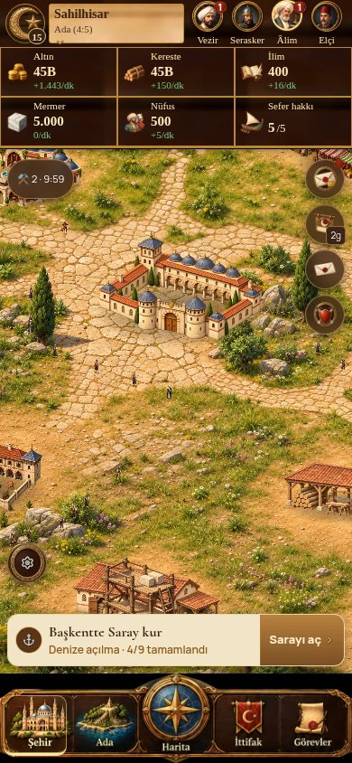
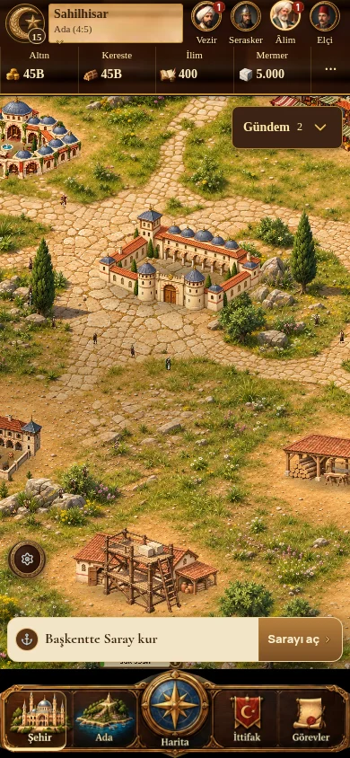
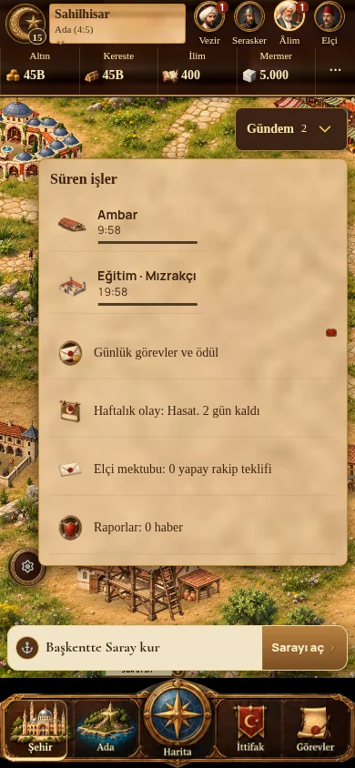
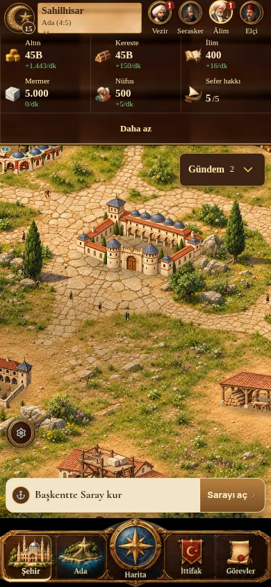

# Ekrana nefes alanı — 0.132.0 / SW157

21 Kasım 2026. Kullanıcının “oyun çok karışık ve sıkışık” geri bildirimi üzerine şehir ve ortak ekran çerçevesinin bilgi sıralaması yeniden düzenlendi. Kullanıcı bu düzenleme talebiyle önceki HUD dondurma notunun yerleşim kısmını değiştirdi; boyalı portreler, arma, ahşap ve alt menü korunur.

## Karar ve uygulama

**Önce şehir ve eldeki kaynak, sonra ayrıntı ve yönetim.** Ana ekranda her bilgi aynı anda görünmez. Altın, kereste, ilim ve adanın özel kaynağı tek sıradadır. Kaynak ayrıntı düğmesi üretim hızlarını, nüfusu ve sefer hakkını açar. Mevcut Hazine ve Üretim sayfasına dokunarak geçiş sürer. Ekran okuyucu etiketleri üretim hızını da içerir.

Normal yazıda ortak üst çerçeve 164 px yerine 106 px: şehir ve her yönetim sayfasına 58 px alan açılır. Büyük yazıda tek sıra zorlanmaz; kompakt görünüm iki sütuna, açık kaynak defteri okunabilir üç sütuna döner. Kaynak kapatılırken büyük yazı boyutu korunur.

Şehrin iki yanındaki faaliyet ve dört kısayol tek **Gündem** düğmesine toplandı. Süren inşaat, eğitim, araştırma ve seferler açıldığında ad, kalan süre ve ilerleme ile listelenir. Günlük ödül, haftalık olay, teklifler ve raporların düğmelerinde açık adlar vardır. Kayıttaki faaliyetlerin ilk dördüyle sınırlama kaldırıldı. Gündem listesi kendi içinde kayar; ana ekrana taşmaz. Görünür tehdit/abluka/işgal uyarısı Gündem’in önüne geçer.

Koloni hedefinin tekrarlayan açıklaması ana şehir şeridinden çıkarıldı; hedef adı ve eylemi kalır, bütün plan görev defterindedir. İlk oyuncunun adım açıklaması, ödül alma ve yönlendirme oku korunur. Eylemler, kayıt ve ekonomi değişmez.

Kaynak ve Gündem ayrıntıları dışarı dokunma/Escape ile kapanır. Ortak geri tuşu katmanına bağlıdır: Android/tarayıcı geri hareketi önce açık ayrıntıyı kapatır. Ayrıntıdan bir yönetim sayfasına geçildiğinde önceki açıklık taşınmaz.

Kaynak satırının yüksekliği değiştiğinde kamera önceki bakış noktasını ve yakınlığı korur; dünya sınırı gerekli olduğunda yakınlık sınırlandırılır. Kaynak ayrıntıları kamerayı yeniden ortalamaz; mevcut harita araçları çalışmayı sürdürür. Şehir parselleri, bina konumları, sanat ve kayıt biçimi değiştirilmedi.

## Kanıt

Aynı örnek kayıt, aynı 390×844 ekran, aynı 1630/950 odak ve 0,7 yakınlık kullanıldı. Yeni konsept çizimi değildir.

## Doğrulama

`tools/city-clarity-qa.cjs`: 5 senaryo geçti. 360×740, 390×844, 430×932; açılan/kapanan kaynaklar, kamera konum ve yakınlığı, Gündem işleri ve hedef sayfası, Escape/geri davranışı, Gündem → Ada → Şehir geçişi, büyük yazı, ilk oyuncu yönlendirmesi ve tehlike önceliği. Önce/sonra ölçümleri kanıt klasöründedir.

396 otomatik test; TypeScript, ESLint ve CSS/V2 sınırları. Android statik derlemesi ve telefon görsel hazırlığı geçti. Tam arayüz taraması 360×740 ve %130 yazıda sıfır taşma, kırpılma, küçük hedef/yazı, çakışma, adsız kontrol ve sayfa hatası verdi. Önceki 8 şehir yaşamı senaryosu da geçti.

## Devam eden tasarım işi

Bu geçiş ortak ekran çerçevesi ve şehirdeki görsel yükü azaltır. Bina yönetim sayfalarının kendi içerik sıralaması, kışla/araştırma yoğunluğu ve genel sanatın tutarlılığı ayrı ayrı ele alınmalıdır. Genel oyun görsel kabulü tamamlandı iddiası değildir. Fiziksel Android kontrolü ve üretim yayını yapılmadı; önceki PR #97 birleştirildiği için bu düzenleme ayrı inceleme dalındadır.
