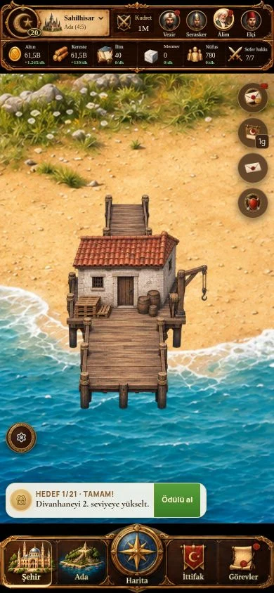
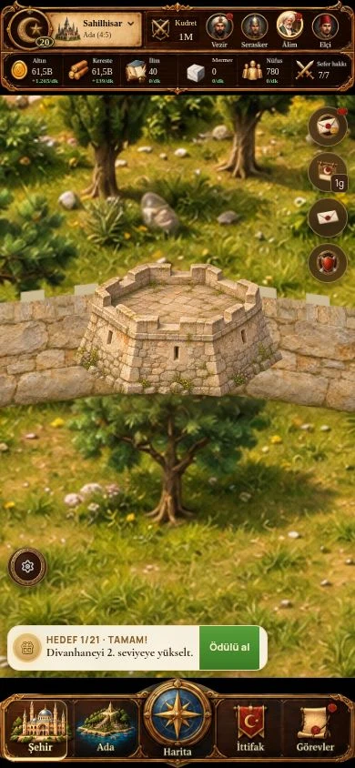

# Kıyı ve sur bağlantıları — 0.126.0 / SW151

8 Kasım 2026. İlk yerleşim düzeltmesi; tüm şehrin sanat yenilemesi tamamlanmış değildir.

## Değişiklik

- Liman ve tersane çatının üst sınırıyla değil, çizimde ölçülmüş kıyı temas noktasıyla hizalanır. İskele suya uzanırken yapı kıyıya bağlanır. Sağ/sol yansıtmada temas noktası da yansır.
- 25–27 görsel kıyı sınırları karaya bağlantı için genişletildi; 27 numaralı sınır komşu kara arsasına girmeden kıyının eğimini izler. Slot kimlikleri ve merkezleri değişmedi.
- Kara bina sığdırması küçük yatay/dikey kaydırmalara daha az ceza verir; gereksiz küçülmeyi azaltır. Bu değişiklik her binanın arsayı tamamen doldurduğu anlamına gelmez.
- Sur köşelerindeki burçlar birleşen duvar yüzlerinin önünde çizilir. Burç yüksekliği duvarla eşleşir; mazgallar ortak taş dokusunu kullanır.
- HUD, motor, ekonomi, kayıt biçimi ve kaynak bina/zemin görselleri değişmedi.

## Doğrulama

- `pnpm check`: 379 test, TypeScript, ESLint ve CSS kontrolleri geçti.
- `STATIC_EXPORT=1 pnpm build`: statik derleme geçti.
- `node tools/v2-criteria.cjs`: geçti.
- Kıyı testleri beş çizim, üç kıyı arsası, full/sm boyları ve iki yansıma yönünde temas, silüet sınırı ve gerçek arazi piksellerini denetler.
- Tarayıcıda 390×844 sahnede liman, tersane, kışla ve sur köşesi incelendi. Limana ve burca dokununca doğru bina paneli açıldı. 28 yapının sahne sınır ölçümleri iki yönde kontrol edildi.
- `tools/layout-qa.cjs` içindeki tarayıcı tarayıcısı şehir görünümünde 360/390/430 genişliklerinde çalıştırıldı: taşma/kırpılma/örtüşme/adsız kontrol bulunmadı. Mevcut HUD küçük yazı ve dört danışman dokunma alanı uyarıları sürüyor. Tam panel gezintisi yapan Playwright komutu çalıştırılmadı; bu kayıt onun yerine tüm arayüzün geçtiğini iddia etmez.
- Fiziksel Xiaomi cihazında test yapılmadı. Görsel kullanıcı kabulü henüz yok.

## Gerçek oyun ekranları

Örnek kayıt, 390×844 tarayıcı görünümü; konsept çizim değildir.

## Kalan görsel kapsam

Tüm bina kataloğunun işlevinin tek bakışta ayırt edilmesi, arsa doluluğu ve zeminle ortak çizim dili ayrıca değerlendirilmelidir. Bu sürüm yeni bina sanatı veya yeni arazi üretmez; önceki bulanıklık şikâyeti tamamen giderilmiş sayılmaz.
