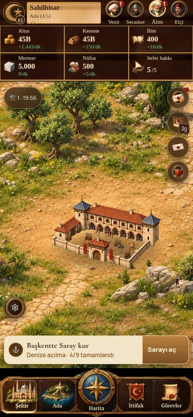
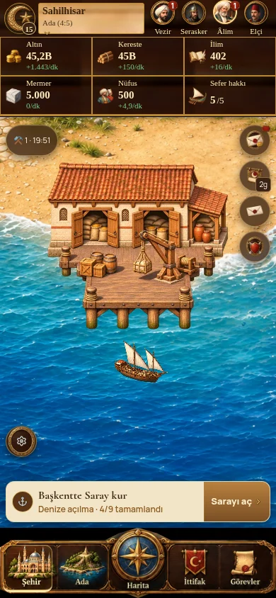

# Yaşayan şehir — 0.131.0 / SW156

21 Kasım 2026. Önceki sabit sekiz yaya ve liman kurulmasa da görünen üç tekne yerine mevcut oyun durumundan türetilen bir şehir katmanı kullanılır.

## Davranış

- Yoldaki halkın sayısı gerçek nüfusa göre artar; normal görünümde en fazla 16 kişi temsil edilir. Bu figürler nüfusun birebir sayımı değildir.
- Kereste işçileri Ambar yolunda balta ve kereste ile, âlimler Medrese–Divanhane yolunda, tüccarlar Çarşı–Liman veya Çarşı–Ambar yolunda görünür. Atama sıfırsa ilgili çalışan görünmez. Meslekler mevcut tam boy kişi çizimlerini kullanır.
- Aktif inşaat sırasında Ambar’dan hedef yapıya malzeme taşıyan işçiler bulunur. Henüz başlamamış sıradaki işler hareket başlatmaz.
- Kışlanın açık avlusundaki en fazla üç talim figürü yalnız devam eden kara birliği eğitimi sırasında görünür. Donanma siparişi veya sadece garnizonda asker bulunması talim başlatmaz; iş tamamlanınca figürler kalkar.
- Ticaret Limanı ve Tersane için birer temsili tekne, gerçek kullanılabilir filodan türetilir. Seferdeki gemiler ve ortak nakliye havuzu, sevk ekranıyla aynı hesaplamayı kullanır. Bina veya serbest gemi yoksa tekne de yoktur. İşgal ve abluka liman hareketini sınırlar.
- Yaya rotaları yalnız mevcut boyalı yol ağı üzerinden hesaplanır. Farklı uzunluktaki yol parçalarında dünya mesafesi kullanılır; dönüşte başlangıca ışınlanma yoktur.
- Tekne, kayıtlı kıyı arsasının gerçek iskele ucunda durur. Kara arsasına taşınmaz.

## Hareket, yaşam döngüsü ve kapsam

Az hareket veya işletim sistemi hareket azaltma tercihi bu katmanı durdurur. Hafif mod en fazla altı halk, meslek başına bir çalışan, iki talim figürü ve tek tekne kullanır. Ayar değişiklikleri yeniden yükleme gerektirmez. Görünmez tam ekran şehir, mevcut uyku davranışını sürdürür. Şehir kapanırken figürler, tekneler ve ayar dinleyicileri temizlenir.

Nüfus, atama, eğitim ve filo değişimleri yalnız bu katmanı uzlaştırır; bina ve araziyi her saniye yeniden kurmaz. Kayıt şeması, ekonomi, eğitim/sefer süreleri, bina çizimleri, parseller ve HUD değişmez. Mevcut kişi çizimleri yol üzerinde hareket eder; yeni yürüyüş kareleri veya yeni bir asker simülasyonu üretilmedi.

## Doğrulama

- 396 motor/sunum testi: nüfus ve gerçek atamalar, kayıt nesnesinin korunması, bütün arsa çiftlerinde yol ağı, sabit yürüyüş mesafesi, aktif/sıradaki/biten işler, donanma ayrımı, işgal/abluka, hafif/az hareket sınırları ve gerçek sefer–dönüş filosu.
- TypeScript, ESLint, CSS ve V2 bütçeleri; statik Android dışa aktarımı ve telefon görsel hazırlığı.
- `tools/city-life-qa.cjs`: 8 derlenmiş senaryo geçti. Gerçek sahnede 360/390/430 genişlikleri; görünür meslekler, hareket ve durma, canlı hafif/az hareket tercihleri, gerçek işçi atama/çekme, biten eğitimin kaldırılması, boş filo ve seferden dönen gemileri denetler. Eksik görsel ve sayfa hatası bulunmadı; rapor `docs/mockups/living-0131/report.json` içindedir.
- Tam telefon düzen taraması 360×740 ve %130 yazı boyutunda sıfır taşma, kırpılma, küçük hedef/yazı, çakışma, adsız kontrol ve sayfa hatası verdi; `layout-report.json` içinde kayıtlıdır.

Görsel kanıtlar örnek şehir kaydıyla derlenmiş oyundan alınır; yeni konsept çizimi değildir.

[Şehirdeki gerçek hareketin kısa kaydı](mockups/living-0131/movement.mp4)

## Açık işler

Fiziksel Android GPU/pil ölçümü ve kullanıcı görsel kabulü tamamlanmış sayılmaz. Genel sanat kataloğunun ve bina seviye çizimlerinin tamamı bu bölümde yenilenmedi. Çalışma PR #97 inceleme dalındadır; üretim yayını yapılmadı.
