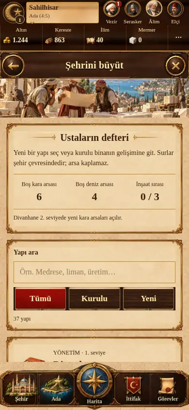
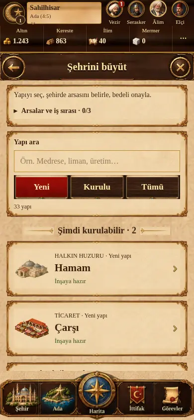
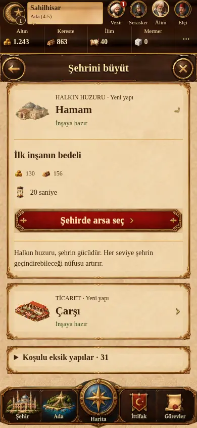

# İnşa seçimi ve arsa onayı — 0.135.0

22 Kasım 2026 · SW160 · Android öncelikli.

İnşa defterinde dekor, arsa hesabı ve filtreler yapıların önündeydi. 390×844 önce kaydında ilk satır 693px’de başlıyor, 745px’de biten içerik alanına sığmıyordu. Yeni düzen, kurulabilir yapıları ve asıl kararı öne alır.

- Katalog Yeni filtresiyle açılır. Motorun `buildReason` koşullarını sağlayan yapılar önce, koşulu eksik olanlar ayrı açılır bölümde görünür. Arama, kilitli yapıların içinde de doğrudan sonuç gösterir; Tümü ve Kurulu korunur. İnşa halindeki yapı Kurulu’da da bulunur.
- Boş arsa sayımları, inşaat sırası ve onaylı ustalar resmi üstteki açılır destek bölümündedir. Dolu sıra ve kapalı/dolu arsa uyarısı bu bölümün dışında kalır.
- Aynı anda bir yapı ayrıntısı açıktır. Açılan satır içerik alanının başına gelir; bedel, süre ve eylem uzun listenin altında kaybolmaz. Bina açıklaması eylemden sonradır.
- Katalogdan yeni kara/deniz yapısı seçmek şehirde uygun arsaları işaretler. Alt yönlendirme seçilen yapıyı, uygun arsa sayısını ve vazgeçme seçeneğini gösterir. Arsa seçimi kaynak harcamaz; önizlemedeki son onay seçilen arsa ile mevcut motor komutunu gönderir. Yeni bina önizlemesindeki uzun katkı hesabı da açılır; arsa, açıklama, bedel ve son onay önde kalır. Kurulu yapılara ve arsa kaplamayan Surlara erişim korunur.
- İlk oyuncu rehberiyle farklı bir yapı seçimi karıştırılmaz. Kayıt, ekonomi, maliyet, süre, sıra sınırı ve arsa geometrisi değişmez. Yeni bina/zemin sanatı üretilmedi; onaylı atlas ve mevcut mimari korunur.

Bina önizlemesinde ayrı bir görsel hata bulundu: eski yalnız-Y animasyonu, pencereyi ortalayan `translateX(-50%)` dönüşümünün üstüne yazıyordu. Açılış boyunca başlık/bedel sağ kenardan taşıyordu. Yeni anahtar kareler X ortalamasını korur; opak parşömen yedeği de tanımlıdır. Hareket azaltma tercihi korunur.

## Gerçek ekran karşılaştırması

Aynı başlangıç kaydı ve derlenmiş oyun; konsept resmi değildir. Önce 0.134 çıktısı, sonra 0.135 çıktısıdır.

## Doğrulama

`tools/construction-clarity-qa.cjs` gerçek katalog seçimini, kaynak harcamadan vazgeçmeyi, açık arsa önizlemesini, seçilen arsaya gerçek inşa emrini, sıradaki yapıyı bulmayı, aramayı, kıyı/korsan uyumunu, dolu sırayı ve %130 metni sınar. `tools/session-bugs-qa.cjs` önceki kayıt/geri/sekme düzeltmelerini ayrıca denetler.

Fiziksel Android ve genel sanat kabulü tamamlanmış sayılmaz. Bu sürüm inceleme dalındadır.

- 397 otomatik test, TypeScript, ESLint/CSS, kullanılmayan sınıf denetimi ve V2 bütçeleri geçti. Android statik dışa aktarımı ve telefon görsel hazırlığı tamamlandı. Java/R8 ve imzalı APK/AAB doğrulaması yapılmadı.
- [Önceki ölçüm](qa/construction-0135/before.json) ve [14 yeni inşa senaryosu](qa/construction-0135/after.json): 360/390/430px seçim, tek açık ayrıntı, görünür eylem, vazgeçme, son onaya kadar kayıt korunması, seçilen arsaya gerçek emir, yapım aşamasındaki yapıya erişim, kilitli arama sonucu; kıyı/korsan uyumu, uygun yeni yapı kalmayan arsa, dolu sıra ve %130 yazı. İlk satır 390px’de 693→484px konumuna geldi ve tamamı görünür oldu.
- Önizleme 0/90/180ms anlarında üç genişlikte ölçüldü: [önce 3/9](qa/construction-0135/motion-before.json), [sonra 9/9](qa/construction-0135/motion-after.json) kare ekran içindedir. Hareket azaltma tercihinde animasyon yoktur.
- Önceki [11 kayıt/geri/sekme senaryosu](qa/construction-0135/session.json) tekrar geçti. [Tam arayüz taraması](qa/construction-0135/layout.json) 360px normal/%130 yazıda taşma, kesik metin, küçük hedef, minik yazı, çakışma, isimsiz kontrol ve sayfa hatası bulmadı.

Üretim yayını yapılmadı. İnceleme ekranları gerçek derlenmiş oyundandır; fiziksel telefon ölçümü veya bütün bina sanatının kabulü değildir.
