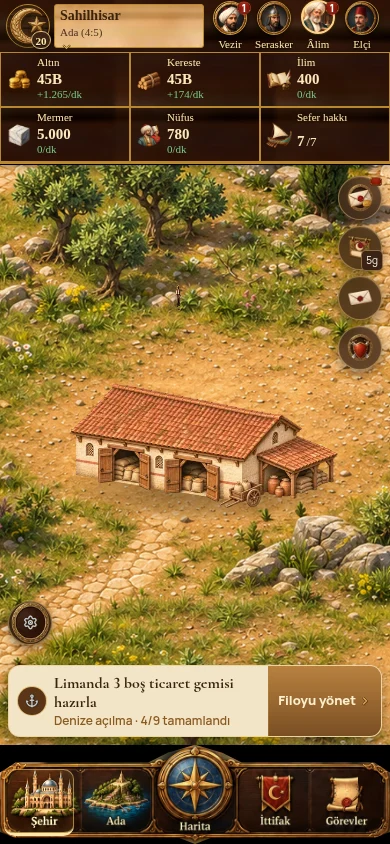
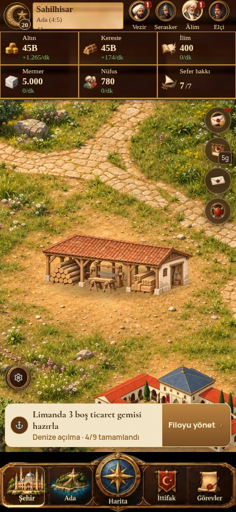
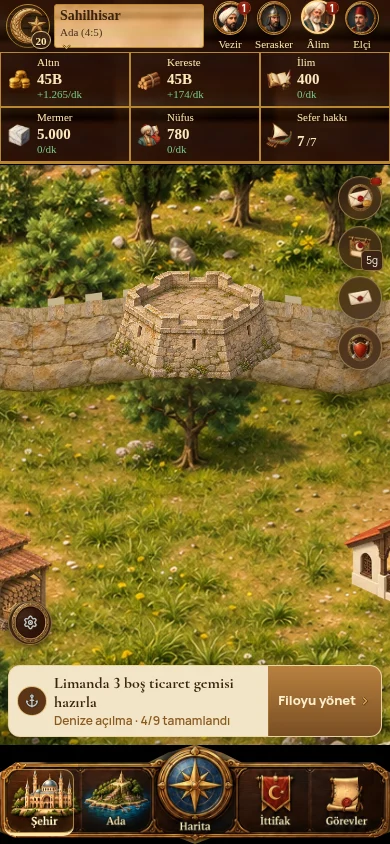
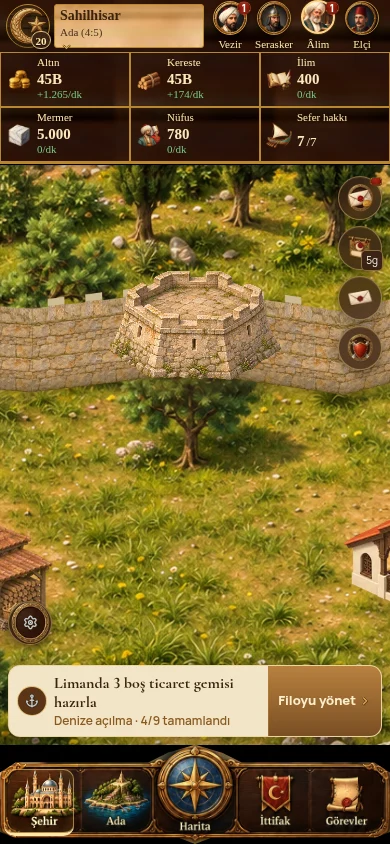
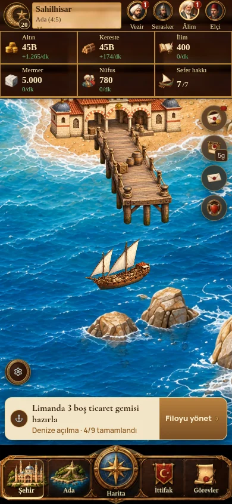

# Üretim yapıları ve kıyı bağlantısı — 0.129.0 / SW154

18 Kasım 2026. Bu sürüm iki üretim yapısını, sur malzemesini ve gemilerin şehirden görsel ayrılışını düzeltir.

## Oyunda değişenler

- Ambar, geniş yükleme kapıları, tahıl çuvalları, kapalı stok bölümü ve el arabasıyla yeniden çizildi. Eski üç silonun yerine alçak ve yatay bir kütle kullanır.
- Kereste Ocağı, açık çalışma sundurması, görünür testere tezgâhı, yuvarlak kütükler ve biçilmiş tahtalarla ayrılır. Eski kubbe kaldırıldı.
- İki çizim de ortak araziyi açık boşluklarından gösteren gerçek alfa kullanır. Zemin plakası, esnetme ve kırpma eklenmez. Tam ve telefon boyları ayrı WebP olarak `public/images/game/buildings/parcel-v8/` içindedir. İstemler, kaynak SHA-256 değerleri ve üretim yöntemi `economy-art-provenance.json` içinde kayıtlıdır. Paketleme aracı `tools/art/prepare-economy-art.cjs` dosyasıdır.
- Sur taşlarının fiziksel ölçüsü seviyeye bağlı değildir. Duvar yükseldikçe yeni sıralar görünür. Doku, görünür yüzün mesafesini biriktirerek kesintisiz hat boyunca köşelerde devam eder. Kapılar, dere geçidi, burçlar ve duvar konumları korunur.
- Geminin başlangıcı, limanın gerçek alfa silüetinin suya en çok uzanan ucundan ölçülür. Sol/sağ/düz yönleri ve 25/26/27 kıyı arsaları izlenir. Gemi genişliği limana uygun 96 dünya pikselidir; doğu limanından çıkış kayalığın önünden batıya, ardından açık suya gider. Gemi hareket yönüne bakar.
- Bu değişiklik sonradan yola çıkan geminin görsel efektidir. Sefer süreleri, ekonomi, kayıt şeması, bina seviyeleri ve arsa kimlikleri değişmez.

## Doğrulama

- 390 otomatik test, TypeScript, ESLint ve CSS kontrolleri geçti.
- Alfa/silüet kontrolleri iki yeni yapıyı tüm 24 kara arsasında, full/sm ve iki yansıma yönünde denetler. Gerçek taban temasları, oran, yol açıklığı ve bütün görünür alfa sınırı korunur.
- Sur testi, doku parçalarının boşluksuz kaplandığını, aynı taş ölçüsünü koruduğunu ve ortak köşelerde mesafenin devam ettiğini denetler.
- Liman testi, çizimdeki gerçek uç noktasını ve geminin alt gövdesinden örnekleri boyalı deniz/köpük üzerinde denetler. Doğudaki kahverengi kayalık bölgesi rotanın dışında kalır.
- Android statik üretim derlemesi ve telefon varlık hazırlığı geçti. V2 küçük bina bütçesi 13,4 MB; sınır 15 MB.
- `tools/economy-city-qa.cjs`: derlenmiş oyunda 16 senaryo. 360/390/430 genişliklerinde yeni yapıların yüklenmesi, alfa sınırları ve gerçek dokunuşla doğru bina paneli; surların 1/5/12/20 seviyeleri; üç kıyı arsasında sol/sağ/düz liman ve iskeleye bağlı gemi ayrılışı denetlendi. Tarayıcı hatası ve eksik varlık bulunmadı.
- Tam arayüz taraması 360×740 ve %130 yazıda yatay taşma, kırpılma, küçük hedef, küçük yazı, çakışma, adsız kontrol ve sayfa hatası bulmadı.

## Gerçek oyun görüntüleri

Örnek şehir kaydı ve derlenmiş Android dışa aktarımı, 390×844 tarayıcı görünümü. Bunlar yeni bir şehir konsepti veya çizime gömülü arka plan değildir.

## Açık kalan kapsam

Yeni bina çizimleri Ambar ve Kereste Ocağı ile sınırlıdır. Diğer yapıların tüm seviye çizimleri, liman/tersane sanatının yeniden tasarımı ve bütün şehir için kullanıcı görsel kabulü tamamlanmış değildir. Fiziksel Android cihazı, GPU/pil ölçümü ve imzalı APK/AAB bu kontrolde denenmedi.
