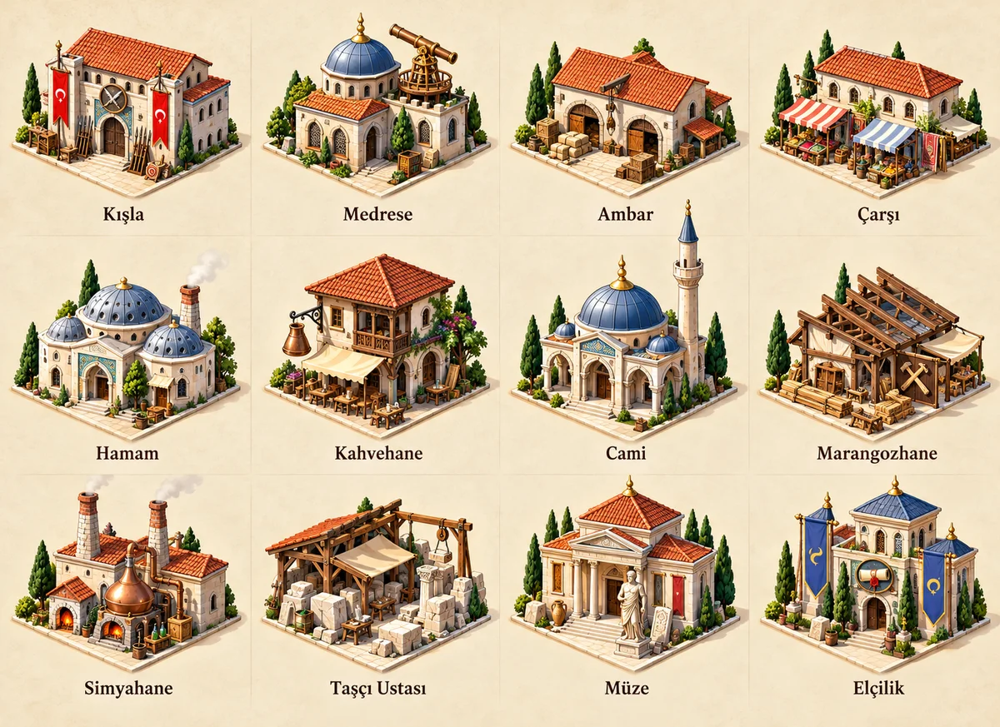
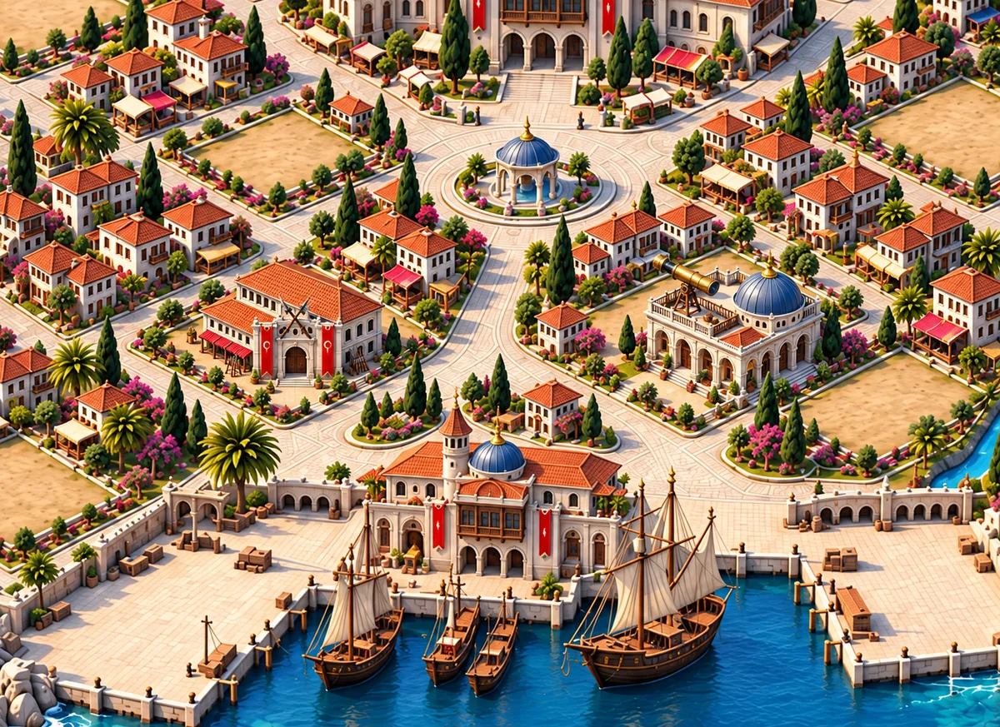
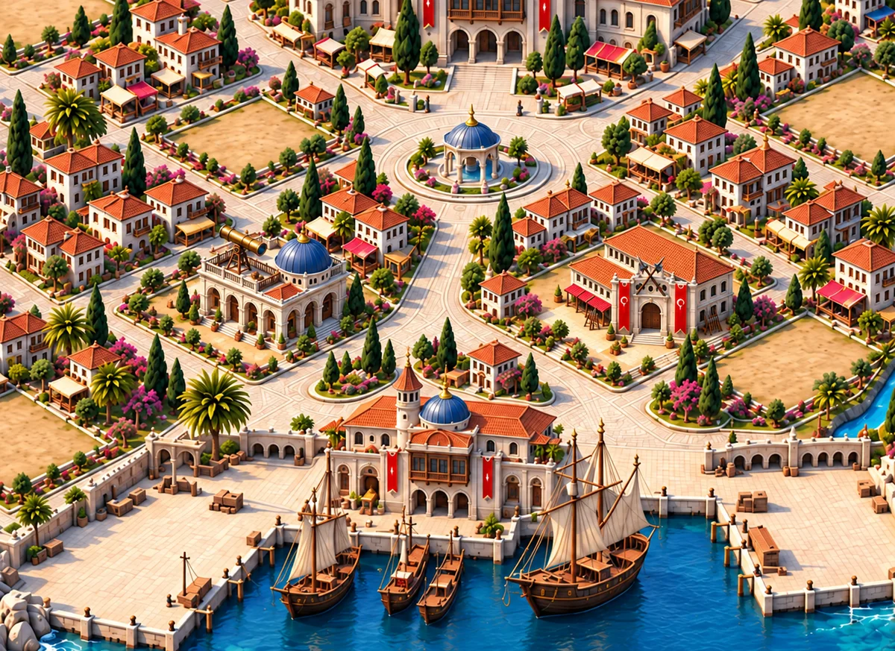

# Ayırt edilen ve her kara arsasına taşınabilen yapılar

11 Ekim Adem'in şartı: oyuncu tek bakışta Kışla/Medrese/diğer bina türünü anlamalı; kara yapıları herhangi bir uygun boş kara arsasında aynı görsel kaliteyle durmalıdır. Yalnız prototip dalı. Mekanik/HUD/kayıt değişmez.

## Ortak olan ölçü; farklı olan mimari

Her türün ana silueti, çatı biçimi ve büyük kullanım işareti ayrıdır. Kiremitli aynı konağın aksesuarlarını değiştirerek yeni aile üretme. Küçük tabelaya, yazıya, ikon rozeti veya yalnız renge dayanma. Siluet düz siyah gösterildiğinde dahi ana gruplar ayrılmalıdır. Yapı türünün ana işareti beş aşamanın tümünde bulunur: Kışla 1 de askerîdir; Medrese 1 de gözlem/öğrenim yapısıdır.

Ortak arsa sözleşmesi: aynı zemin izi, aynı ön giriş bağlantısı, aynı kamera/çatı eksenleri, aynı komşu evlerden alınan kat yüksekliği, aynı sol üst ışık. Görsele genel yol, çiçeklik, ağaç, mahalle duvarı veya çevre zemini gömülmez. Yapıya ait avlu/raf/tezgâh/giriş basamağı da bu ortak izin içinde kalır. Oyuncu taşıdığında dünyaya ait bitkiler/yollar taşınmaz. Zemine temas gölgesi ve kısa yol bağlantısı arsa katmanında üretilir.

Ortak zemin izinin ölçüsü en küçük gerçek kullanılabilir kara arsasına göre belirlenir; mevcut otomatik 60×36 hit-area bu ölçünün doğruluğunu kanıtlamaz. Büyük binaları bir arsaya göre çizip diğer arsada rastgele küçültmek yasaktır. Çatı saçağı ve teleskop gibi üst bölüm uzantıları için ayrıca ortak görsel sınır gerekir. Seviye 20 yapının komşunun girişini veya dokunma hedefini gizlemesine izin verilmez.

## Katalogdaki bütün aileler için kimlik

Bu tablo `lib/game/core/data.ts` içindeki 37 gerçek yapı adını kapsar. Görsel yön tarifidir; tamamlanmış 185 asset anlamına gelmez.

| Yapı | Ana biçim / siluet | Büyük ayırt edici öğe |
|---|---|---|
| Divanhane | Merkezî büyük kubbe, simetrik idarî giriş | Resmî giriş revakı; belediye sabit konumda |
| Konaklar | Birbirine bağlı konut çatıları, cumbalı cephe | Aile balkonları; askerî/bilimsel öğe yok |
| Kereste Ocağı | Açık uzun kesim sundurması | Büyük yatay tomruk ve kesim düzeneği |
| Ambar | Alçak geniş depo, çift yükleme kapısı | Büyük çuval kümeleri ve tahıl ağzı |
| Medrese | Çatı gözlem terası, küçük kurşun mavi kubbe | Büyük pirinç teleskop; minare/silah/sancak yok |
| Çarşı | Alçak, açık tezgâhlı sıralı dükkânlar | Birkaç büyük renkli tente |
| Hamam | Üç alçak delikli kubbe | Buhar bacası; minare yok |
| Saray | Yüksek merkez köşk, derin resmî portal | Saltanat balkonu; kara arsasının içinde |
| Elçilik | İnce diplomatik köşk ve açık balkon | Mavi tören flaması ve büyük mühür biçimli giriş |
| Kışla | Uzun kompakt koğuş, güçlü askerî portal | İki büyük kırmızı sancak ve çapraz silah biçimi |
| Surlar | Şehir çevresindeki kesintisiz savunma hattı | Burç/kapı ritmi; kara arsası tüketmez |
| Ticaret Limanı | Açık yükleme revakı ve iskele | Yük vinci, sandıklar; kıyı ailesi |
| Tersane | Yüksek açık tekne çatkısı | Büyük yapım halindeki tekne; kıyı ailesi |
| Kahvehane | Ahşap balkon, derin oturma sundurması | Büyük bakır cezve/ikram öğesi |
| Cami | Tek büyük kubbe, ince uzun minare | Minare; Medrese/Hamam ile karışmaz |
| Müze | Sütunlu resmî sergi cephesi | Girişte büyük taş eser |
| Marangozhane | Açık ahşap işleme atölyesi | Büyük kirişler ve testere |
| Mimarbaşı Odası | Küçük yükseltilmiş çizim köşkü | Dışa açılan büyük plan masası ve ölçüm pergel biçimi |
| Ormancı Evi | Küçük ahşap çatılı bakım evi | İç sınırda birkaç belirgin fidan rafı |
| Taşçı Ustası | Açık taş kesme sundurması | Büyük işlenmiş taş blokları |
| Kahve Fidanlığı | Alçak bakım serası/sundurması | Sınır içinde belirgin yeşil fide sıraları |
| Simyahane | Çift bacalı kompakt fırın yapısı | Büyük damıtma kabı; Medrese teleskobu yok |
| Camcı Atölyesi | Tek yüksek fırın bacası, açık çalışma cephesi | Büyük turkuaz cam kaplar |
| Kahve Kileri | Kısmen gömülü kiler ve kalın kemerli giriş | Kahve çuvalları; Ambar gibi çift yükleme kapısı yok |
| Gözlükçü | İnce dükkân, büyük açık vitrin | Büyük çift mercek biçimi; çatı teleskobu yok |
| Barut Deneme Alanı | Alçak kalın taş deney odası | Sınır içinde korumalı büyük hedef levhası |
| Depo | Yüksek dikey istif yapısı, üst yük kapısı | Dış cephede halat makarası; Ambar'dan farklı kütle |
| Ticaret Merkezi | İki katlı geniş galerili ticaret hanı | Üst kat terazi biçimi; Çarşı gibi tente sırası yok |
| Harita Arşivi | İnce arşiv kulesi ve alt revak | Büyük rulo harita; teleskop/minare yok |
| Korsan Kalesi | Küçük sert kayalık savunma kütlesi | Korsan flaması; özel ada yuvası |
| Ahi Tekkesi | Ahşap revaklı sade toplanma yapısı | Büyük lonca düğümü ve usta çalışma kapısı |
| Ongun Mabedi | Yüksek açık ahşap direkli kutsal yapı | Belirgin oyma ongun; kubbe/minare yok |
| Karagöz Perdesi | Alçak açık gösteri köşkü | Büyük çerçeveli perde; içinde iki gölge figürü |
| Kara Pazar | Kapalı/örtülü kompakt satış yapısı | Koyu tenteler, büyük kilitli kasa; açık Çarşı'dan farklı |
| Gizli Sığınak | Alçak gömülü giriş, dar mazgallı kapak | Küçük gizli gözetleme başlığı; büyük saray silueti yok |
| Valilik | Tek merkez köşklü resmî taş konak | Valilik sundurması; Saray'dan daha sade siluet |
| Tophane | Kalın fırın bacalı döküm atölyesi | Büyük top namlusu; Kışla koğuşu yok |

## Beş aşamanın kuralı

1 / 5 / 10 / 15 / 20: bina kendi seviyesine göre değişir. Temel tür silueti ve ana işaret kaybolmaz. İlk aşamalar arsa içinde daha küçük olabilir; yüksek aşamalar ortak zemin/görsel sınırını büyütmez. Kat, kapı, çatı ve işlev ekipmanı gelişir. Beş aşamada giderek saraya dönüşen aynı mimariyi bütün türlere yayma.

## Gerçek kabul kontrolleri

1. Görseller 64px ve gerçek 390px oyun görünümünde etiket kapalıyken incelenir. Siyah siluet ve gri ton karşılaştırması da yapılır. Oyuncu testi yapılmadan “tek bakışta herkes tanır” sonucu iddia edilmez.
2. Her aile × beş aşama × bütün uygun kara arsa kimlikleri için zemin poligonu, giriş bağlantısı ve komşu görsel sınırı denetlenir. Sadece boş şehirde değil, komşular da en yüksek seviyedeyken bakılır. Arka plan belediye 1/5/10/15/20 durumları da kapsanır.
3. Kışla/Medrese aynı arsada dönüşümlü gösterilir; iki farklı arsada yerleri değiştirilir. Ölçek/origin rastgele değiştirilmez. Bu iki örnek bütün ailelerin/bütün arsaların testi değildir.
4. Geometri kimlik, hit-area ve ekran sınırı testleri, boyalı arazinin kullanılabilir olduğunu tek başına kanıtlamaz. Mevcut 12 açıklıktan otomatik ikili arsa üretimi görsel olarak denetlenmeden referans kabul edilmez.
5. Liman/Tersane kıyı yuvalarını, Korsan Kalesi kendi ada yuvasını, Surlar çevre hattını kullanır. Her kara arsasına uyum şartı bu oyun kurallarını değiştirmez.

## Bu turdaki üretim

Dosyalar: `glarium-building-identity/identity-board.webp` — 12 aile sanat yönü levhası; `context-a.webp` — sol Kışla / sağ Medrese. Levhadaki çevre/dekor ve döşeme yalnız tasarım sunumudur; üretim sprite'ına alınmaz. Bağlamın arka planı üretim sırasında yeniden örneklenmiştir; oyunun orijinal tabanının piksel düzeyinde aynı kaldığı veya gerçek ölçülerin doğrulandığı iddia edilmez.

`context-b-swapped.webp` aynı bağlamda sol Medrese / sağ Kışla olarak yer değiştirme tasarımıdır. Görsel incelemede iki tür kendi çatı/kapı kimliğini korur; sokak/fıskiye/mahalle konumu büyük ölçüde korunur. Bu üretken tasarım karşılaştırmasıdır; gerçek oyun taşıma testi değildir. Zemin ölçülerinin birebir eşitliği ve bütün arsalar için çakışma kontrolü henüz doğrulanmadı.

Yerleşik imagegen; gerçek `hall-20.webp` kamera/ölçek/malzeme referansı. İki çalışma: (a) aynı zemin ölçüsünde farklı Kışla/Medrese'nin gerçek arka plan referanslı iki komşu arazide bağlam tasarımı; (b) 12 örnek aile için tek sanat yönü levhası. İstemler büyük çatı/cephe farkı, aynı arsa izi/giriş yönü, küçük ölçekte belirgin işlev ve çevreyle aynı ışık/malzeme şartlarını taşır. Bunlar sanat önizlemeleridir; henüz şeffaf üretim assetleri veya gerçek oyun ekranı değildir. Bütün arsalar/bütün aileler için çalışma zamanı doğrulaması bu turda tamamlanmamıştır.
