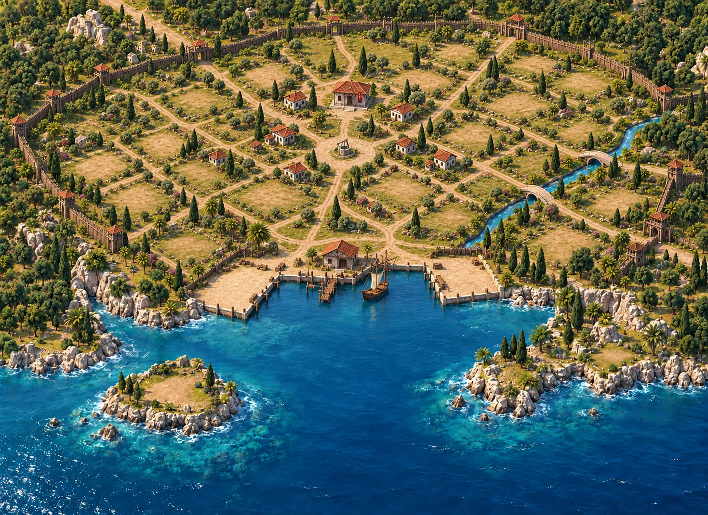
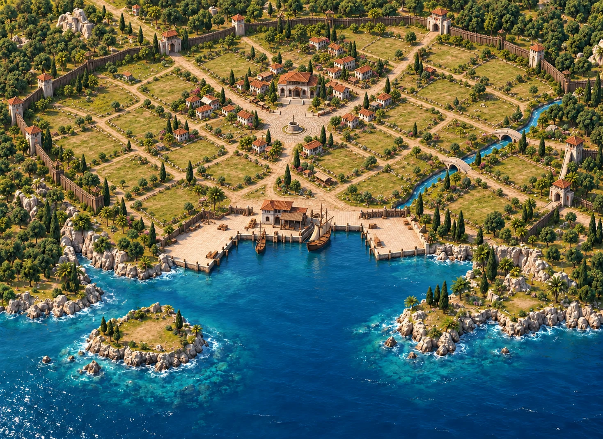
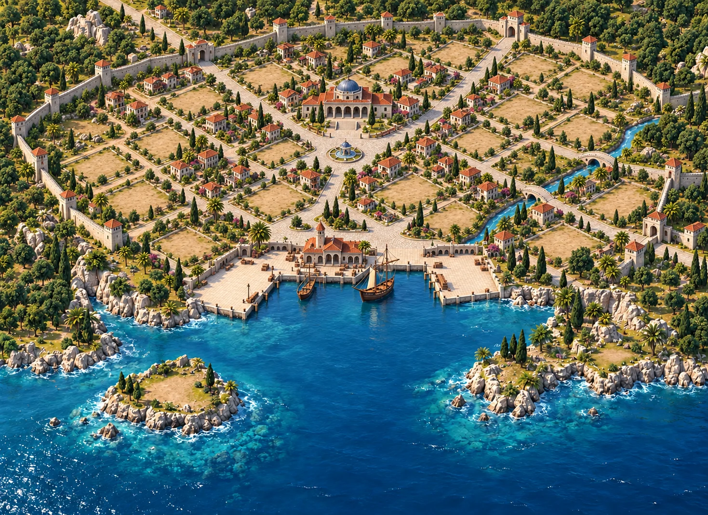
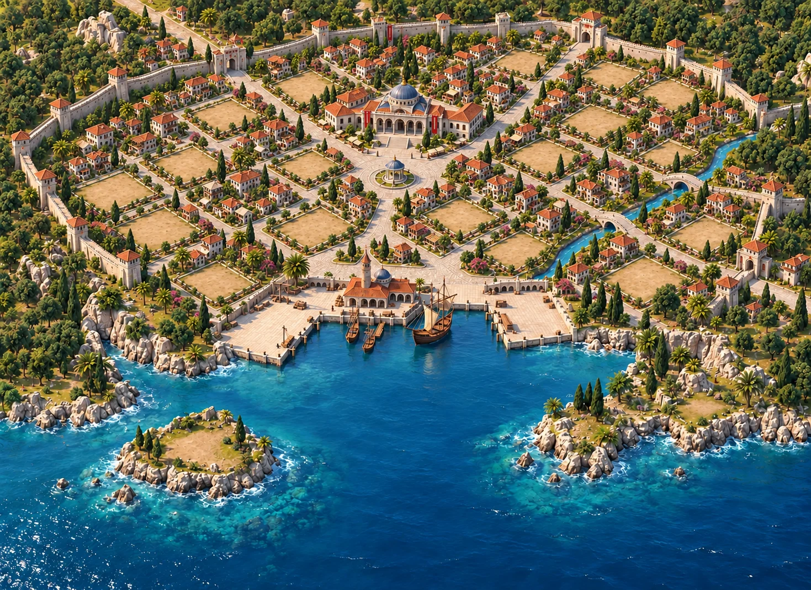
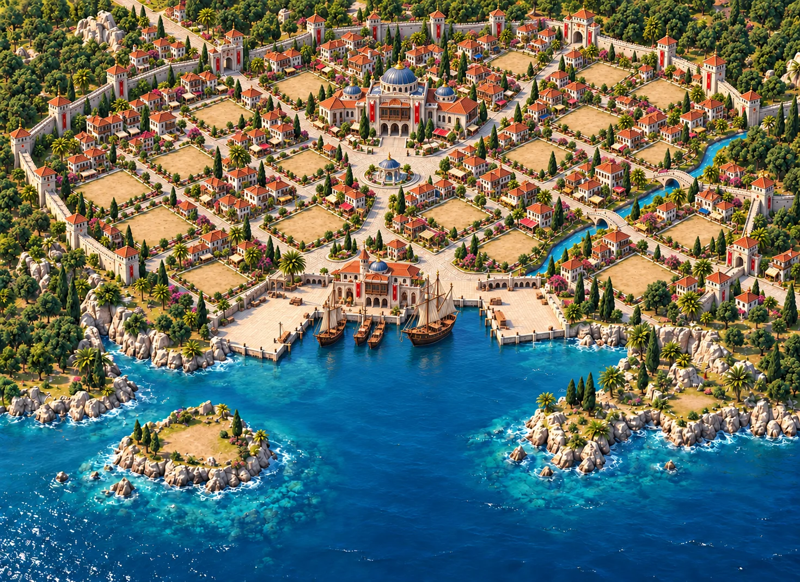
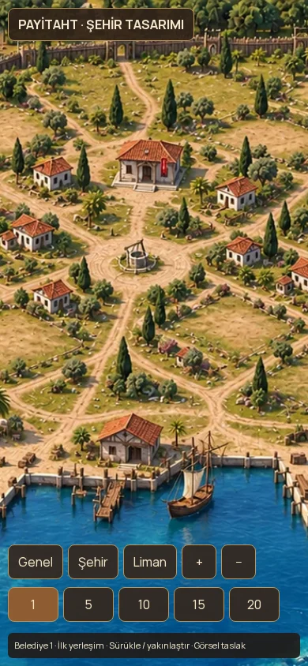
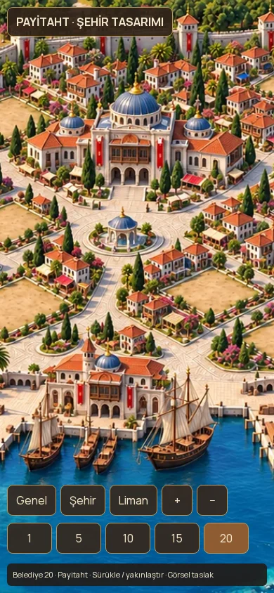

# Glarium yerleşimine göre beş aşamalı Osmanlı şehir tasarımı

11 Ekim 2026 · `prototype/glarium-ottoman-city` · `/glarium-city`

Glarium'un geniş koy, orman çerçevesi, sağ dere ve zeminden ayrı bina yaklaşımı mekânsal referanstır. İncelenen Glarium `City.tsx` belediye seviyesine göre beş şehir zemini seçmiyor; bu beş aşamalı gelişim Payitaht için yeni tasarımdır. Glarium'un `IslandCities.tsx` şehir seviyesine göre sprite aşamaları seçme fikri de örnek alınmıştır.

| Belediye | Şehir evresi | Görsel gelişim |
|---|---|---|
| 1–4 | İlk yerleşim | Küçük sivil divanhane, birkaç ahşap/kiremit ev, çoğunlukla yeşil açıklıklar, toprak patikalar, basit rıhtım |
| 5–9 | Kasaba | Merkez çevresinde ilk mahalleler, gelişen taş temel, ana yolda ilk döşeme, küçük ticaret çevresi |
| 10–14 | Şehir | Merkezden dışa genişleyen konut dokusu, belirgin taş meydan, gelişmiş ana yollar, büyüyen liman çevresi |
| 15–19 | Büyük şehir | Dış mahalleler yoğunlaşır, evler ve sivil yapı detayları zenginleşir, taş sokak ağı olgunlaşır |
| 20 ve üzeri | Payitaht | Görkemli sivil divanhane, tam gelişmiş mahalleler ve meydan/rıhtım dokusu |

## Tasarım kuralları

- Belediye bir sivil idare binasıdır; minareli cami yerine divanhane. Seviyeyle görünümü gelişir; merkezi yeri değişmez.
- Gelişme, merkezden dış mahallelere uzanan konut dokusudur; haritanın kamera açısı veya dünya boyutunu değiştirmek değildir.
- Koy, dere, köprü, çevre ormanı ve korsan adası beş görselin ortak coğrafyasıdır.
- Oyuncunun inşa edeceği yapılar için açıklıklar korunur. Kışla/medrese/ambar gibi yapılar otomatik olarak belirli arsalara konulmaz. Seviye artışı inşa edilmiş gibi sahte oyun yapıları göstermemeli.
- Bir mevcut kıyı binası yanında iki boş rıhtım ve boş korsan adası tasarımda tutulur. Oyundaki üç kıyı ve korsan kimlikleri değiştirilmez.
- Yeni beş raster taslak; ev, yol ve çevre gelişiminin art direction çalışmasıdır. 24 arsanın motor indekslerine kalibre edildiği veya tüm binaların ayrı oynanabilir katmanlar olduğu iddia edilmez.

## Önizleme davranışı

Belediye 1/5/10/15/20 düğmeleri aynı Phaser sahnesindeki görseli değiştirir. Kamera pan/zoom konumu evre değişiminde korunur. `?hall=9` kasabayı, `?hall=19` büyük şehri, `?hall=40` Payitaht'ı gösterir. Seviye eşikleri saf bir görsel fonksiyondur; maliyet, inşaat, ekonomi, halk, oyun kaydı ve canlı HUD değişmez. Bu prototip mevcut kayıt dosyasından seviye okumaz; query/düğme ile görsel gelişimi inceler.

## Assetler ve üretim

Beş görüntü Imagegen ile ayrı ayrı üretilmiştir. Ortak olgun şehir coğrafyası, erken seviyelerde seyrek yerleşime dönüştürülmüştür; son 20. seviye 15'in gelişmiş devamı olarak zenginleştirilmiştir. Prompta ortak kompozisyon ve ayak izlerini koruma, minarelerin kaldırılması, sivil divanhane, oyuncu arsalarının boş bırakılması ve Osmanlı-Ege renk/malzeme/ışık standardı belirtilmiştir. Dosyalar 1469×1070 boyutuna dönüştürülüp WebP olarak kaydedilir. Görsel coğrafya tutarlılığı konsept seviyesindedir; piksel hassasiyetinde anchor kayıt garantisi değildir.

Canlıya yayın yapılmaz. Sonraki oynanabilir entegrasyonda binasız taban, ayrı belediye/bina assetleri ve kesin render anchor eşleştirmesi gerekir.

## Beş aşamanın görselleri

### Belediye 1

### Belediye 5

### Belediye 10

### Belediye 15

### Belediye 20

## Kontroller

- 347 test geçti; bunlardan ikisi 1/5/10/15/20 eşiklerini, ara seviyeleri, 20 üzerini ve geçersiz girdileri kontrol eder.
- TypeScript, tüm ESLint, CSS lint ve production build geçti. `v2-criteria` sınırları sağlandı.
- `pnpm check` içindeki `tsx` CLI bu ortamda IPC soketi için EPERM aldı. Aynı test dosyaları `node --import tsx --test` ile çalıştırıldı; tek komutun başarılı olduğu iddia edilmez.
- 1440×1000 ve 390×844'te beş aşama ayrı piksel çıktılarıyla doğrulandı. Eksik asset, sayfa hatası ve yatay taşma yok. LocalStorage değişmedi. Pan/wheel/pinch olayları ve yatay ekran dönüşü denendi.
- `?hall=4/9/14/19/40` açılışları doğru evreyi seçiyor. Görsel kamera ayarları değişmeden evre değiştirme kodu kullanılıyor.
- Genel oyunun layout taraması çalıştırıldı: taşma/kesik/çakışma/isimsiz/sayfa hatası 0; 312 küçük hedef ve 664 küçük yazı bildirimi nedeniyle kontrol başarısız. Bildirimler değiştirilmeyen mevcut oyun/HUD sayfalarında; bu iş genel UI düzeltmesi değildir.
- Gerçek cihaz GPU, pil veya uzun süreli performans ölçümü yapılmadı.

### Telefonda aynı kamerayla ilk ve son evre

