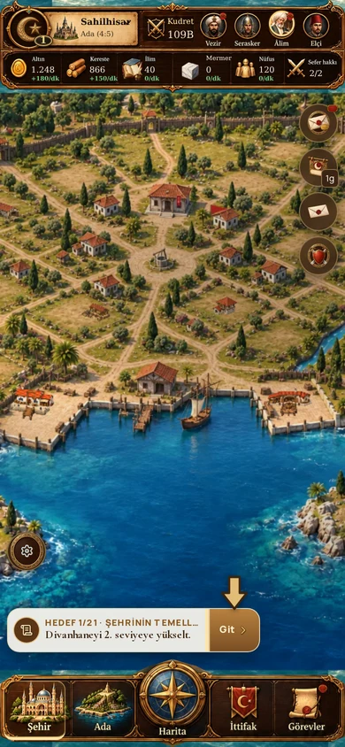
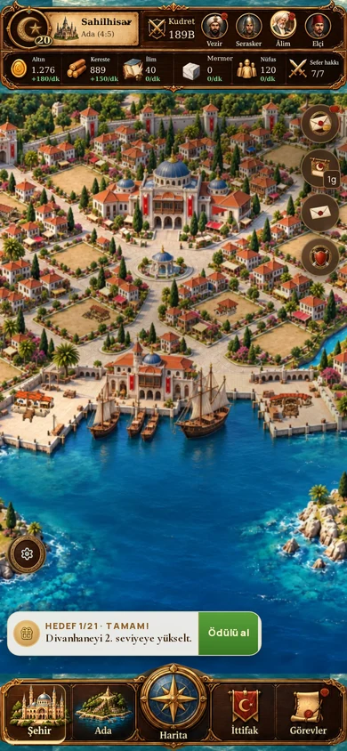
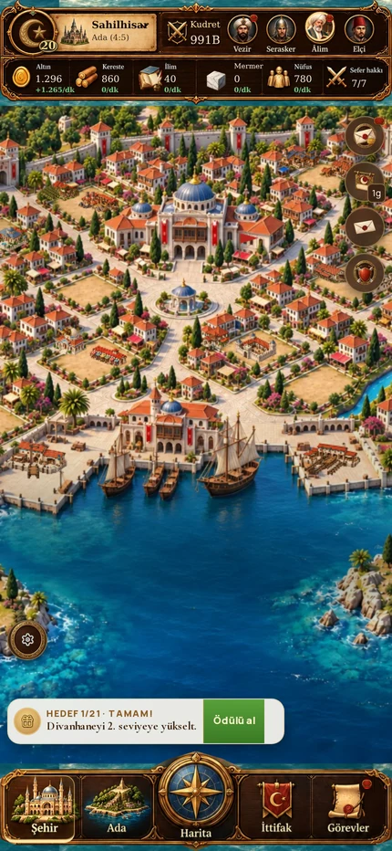

# Onaylı Glarium esintili şehrin oyun entegrasyonu

**Sonraki çalışma:** Kışla’nın beş ayrı görseli ve kendi seviyesinden seçim sistemi tamamlandı; bkz. `GLARIUM-FIVE-STAGE-BUILDINGS.md`. Diğer bina aileleri henüz dönüştürülmedi.

Çalışma dalı: `prototype/glarium-ottoman-city`. Ana/canlı dal değiştirilmedi.

Onaylanan beş şehir resmi artık yalnız `/glarium-city` sunumu değildir. Ana oyun sayfasındaki `CityCanvas`, gerçek şehir `Game` verisini `glarium-playable-city.ts` sahnesine verir. Belediye seviyesi 1–4 / 5–9 / 10–14 / 15–19 / 20+ aralıklarında ilgili resmi seçer. Görünüm değişimi kamerayı sıfırlamaz. Koloni değişiminde mevcut kabuk sahneyi yeniden kurar.

## Yerleşim ve işlemler

- Motorun 0 belediye, 1–24 kara, 25–27 kıyı, 28 korsan adası kimlikleri korunur.
- `city-slots.json`, motor, kayıt şeması, ekonominin bedelleri ve açılma kuralları değiştirilmez. Yeni resme oturma yalnız `glarium-playable-layout.ts` sunum koordinatlarında yapılır.
- Resimdeki geniş açıklıklar ikişer küçük oyun arsasına ayrılır. Belediye sabittir; diğer binalar kayıttaki `placement` kimliğine göre çizilir. Bütün arsa merkezleri ve temel hit alanları çakışma testinden geçer.
- Kurulu yapılar mevcut şeffaf bina görselleridir; bina aşaması, yön ve kıyı yönü okunur. İlk inşada şantiye, devam eden işte mevcut kuyruktan süre görünür. Büyük kaynak resimleri GPU'da küçültülmeden önce bir defa Canvas2D ile küçültülür; minik yapılardaki titreşen/piksel piksel örnekleme azaltılır.
- Belediyeye/binalara dokunma mevcut yapı önizlemesini açar. Boş açık arsa mevcut inşa seçicisini açar. Taşımada dokunma veya sürükleme yalnız uygun açık arsayı seçer; onay mevcut `move` komutunu, iptal mevcut iptal akışını kullanır. Sahne kayıt yazmaz.
- Maden, surlar, limana odaklanma, şehir merkezleme, pan, tekerlek ve iki parmak yakınlaştırma vardır. Mevcut ekran okuyucu bina listesi, HUD ve sayfalar korunur.
- Mevcut gökyüzü/gece katmanı kullanılır. İşgal/abluka mevcut kuşatma verisinden renk ve durum işareti alır. Sefer olayları kısa dünya içi hareket işareti oluşturur.

## Açık sınırlar

Bu ilk oyun içi uygulamadır; beş resim hâlâ düzleştirilmiş boyalı sahnelerdir. Mahalle evleri, belediye, çevre duvarları, merkez liman binası ve resimdeki gemiler zemine gömülüdür. Dekor evler ayrı oyuncu konutu değildir; merkezdeki liman yapısı bir sahne dekorudur, üç oyun kıyı yuvası ayrı sprite'lardır. Resimdeki çevre duvarının şekli belediye aşamasıyla değişir, gerçek Surlar seviyesinin ayrı görsel modeli henüz yoktur. Belediye tıklanabilir ama resimden ayrılmış bağımsız sprite değildir. Su/nehir resmin içinde statiktir.

Önceki prosedürel sahnenin bütün vatandaş, kervan, devriye, duman ve kuş animasyonları yeni koordinatlara taşınmadı. Eski `phaser-city.ts` silinmedi. Bu dal bu nedenle doğrudan canlıya birleştirilmedi. Yeni bina resimleri ve bağımsız sur/su/hayat katmanları için ayrıca görsel uyum çalışması gerekir; mevcut bina resimleri onaylı zemine bağlı ilk uyumluluk katmanıdır.

## Kontroller

349 test (347 önceki + 2 kimlik/geometri testi) geçti. Üretim derlemesi, TypeScript, ESLint, CSS denetimi ve v2 ölçütleri geçti. `pnpm check` test adımında ortamın `tsx` IPC soketi `EPERM` hatası verir; aynı testler `node --import tsx --test` ile çalıştırıldı.

390×844 ve 430×844 gerçek oyun sayfasında beş aşama ayrı ayrı açıldı; resim hatası/JavaScript hatası ve sayfa taşması yok. Belediye dokunuşu → yapı yönetimi, boş arsa seçicisi ve Kışla taşıma önizlemesi/onayı gerçek arayüzden doğrulandı. Tam dolu şehirde 24 kara yapısı + belediye + liman/tersane/korsan kalesi olmak üzere 28 kayıtlı yapı çizildi. Pan, tekerlek ve 932×430 yatay yeniden boyutlama kontrol edildi. Bunlar otomatik tarayıcı kontrolleridir; gerçek telefon pil/ısınma ölçümü yapılmadı.

Kanıtlar: `glarium-integration/validation.json`, `full-validation.json` ve ekran görüntüleri.

Genel `tools/layout-qa.cjs` denetimi tamamlandı fakat mevcut HUD/sayfalardan gelen 312 küçük dokunma alanı ve 664 minik yazı uyarısı nedeniyle başarısızdır. Taşma, kesilme, çakışma, isimsiz kontrol ve sayfa hatası sıfırdır. Sayılar bu dalın önceki genel denetimiyle aynıdır; HUD bu çalışmada değiştirilmedi.

### Gerçek oyun görüntüleri

Tekrar kontrol: çalışan yerel sunucuda `node tools/glarium-playable-qa.cjs` ve `node tools/glarium-full-city-qa.cjs` (Playwright gerekir). `QA_URL` sunucu adresini; `PLAYWRIGHT_CHROMIUM_EXECUTABLE` isteğe bağlı tarayıcı yolunu belirler.
