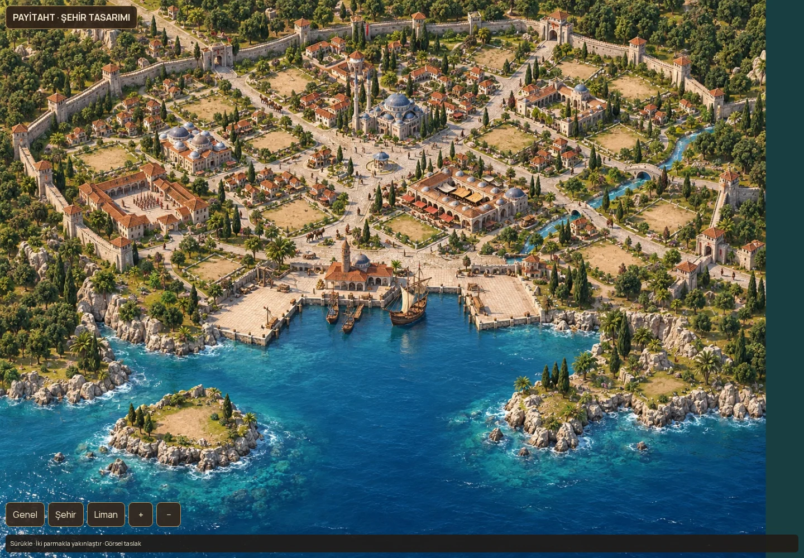
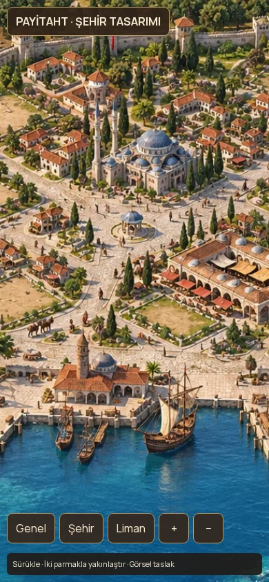

# Glarium incelemesi ve Payitaht Osmanlı şehir denemesi

11 Ekim 2026. Kaynak: https://github.com/verza22/glarium, incelenen commit `fb8c7c8`. Payitaht başlangıcı: `prototype/city-base-v1`, `a001f8a`. Çalışma dalı: `prototype/glarium-ottoman-city`. Ana dal ve canlı geliştirme dalı değiştirilmedi.

## Sonuç

Glarium geniş harita üzerinde ayrı görsellerle bina gösterme konusunda iyi bir referans. Ancak tamamlanmış bir Ikariam motoru veya modern mobil şehir renderer'ı değil. Payitaht için yararlı olan taraf kompozisyon ve veri ile görselin ayrılması. Kaynak ve görseller doğrudan kopyalanmadı; bu incelemede lisans dosyası bulunmadı. Osmanlı konsepti yeni üretildi, önizleme kodu yeniden yazıldı.

## Gerçekte nasıl çalışıyor?

| Konu | Kaynakta görülen | Payitaht kararı |
|---|---|---|
| Şehir zemini | `frontend/src/screens/City.tsx`: CSS ile 2460×1794 dünya; `assets/img/city/city.jpg` tek raster | Aynı genişlik hissi, orman çerçevesi, koy ve sağdan gelen dere; yeni Osmanlı çizimi |
| Bina yerleri | `City.tsx` içinde 15 sabit top/left koordinatı; görünüm 0–14 indeksli | Mevcut belediye 0, kara 1–24, kıyı 25–27, korsan 28 kimlikleri korunacak; görsel projeksiyon ayrı |
| Bina grafikleri | `BuildingImage.tsx`: bina türüne göre PNG; seviye seçiminde kullanılmıyor | Belediye ve bina gelişim aşamaları Payitaht'ın mevcut sisteminde kalmalı |
| Boş yer / inşaat | `Building.tsx`: `ground.png`, `construct.png`, geri sayım | Ortak avlu + inşaat katmanı; her boş arsaya herhangi bir uyumlu kara binası |
| Ölçek / origin | Çoğu bina 140×125; belediye 190×150; liman 215×150; özel türlerde offset | Tür başına açık footprint, ayak noktası, giriş socket'i ve y-göre derinlik sırası |
| Kamera | `DragToScroll.tsx`: mouse/touch ile DOM scroll, başlangıçta yatay merkezleme | Phaser korunur; harita üzerinde pan, pinch ve wheel; HUD sabit |
| Yol | İncelenen şehir renderer'ında rota grafiği veya bina girişini bağlayan yol üretimi yok | Bu özellik yeni çizim ve ayrı yol katmanında tasarlanmalı |
| Deniz / dere | Şehir arka planında resme gömülü; City renderer'ında su animasyonu yok | Üretim sürümünde kıyı maskesi ve shader/animasyon katmanı gerekir |
| Ada | `Island.tsx`: ocean + ayrı ada resmi; şehir ve kaynak hotspot'ları | Şehir/ada/dünya ayrımı korunur; şehir UI'sından bağımsız kamera |
| Ada şehir seviyeleri | `IslandCities.tsx`: farklı sprite sheet offset'leri | Şehir büyümesi için yararlı bir aşama fikri; sprite'lar alınmaz |
| Dünya | `World.tsx`: 100000×100000 DOM alan, 238×120 konum adımları | Mevcut motor/dünya sistemi korunur |
| Bina detayları | `containers/modal/building/Building.tsx`: ana bina işlevi ve ayrı yükseltme alanı | Onaylı Osmanlı UI korunur; buradaki masaüstü pencere düzeni taşınmaz |
| Veri | React Query + Zustand, Node/Express, Prisma/MySQL, shared TypeScript modelleri | Bu görevde ekonomi/kayıt/backend taşınmaz |

Şehir görsel bütünlüğü: coğrafyanın ortak kompozisyonu, benzer kamera ve ışık, bina PNG'lerindeki zemin/avlu parçaları. Bu son yöntem farklı binalarda zemin çiftlenmesine yol açabilir; Payitaht'ta avlu, gölge ve bina ayrı katmanlarda olmalı. Kaynakta y-sort veya genel occlusion çözümü görünmüyor; DOM sırası görsel çakışmalar için yetersiz kalabilir.

## Tamamlanmış sanılmaması gereken kısımlar

1. `City.tsx` 0–14 yer gösteriyor; `buildingController.ts` `available/create` 1–15 kabul ediyor. Belediye için 0 özel olsa bile görünümdeki son normal yer 14, backend'deki 15'in karşılığı yok.
2. `BuildingBL.ts` bildirim yayını için TODO içeriyor; `chatController.ts` WebSocket bildirimi TODO. README'deki gerçek zamanlı bildirim iddiası bu incelenen kodlarda tamamlanmış görünmüyor.
3. `BuildingBL.lessBuildingCost` yardımcısı TODO; controller bunu `nextLevel.level` ile çağırırken parametre ismi `buildingLevelId`. Maliyet indirimi hazır örnek diye taşınmamalı.
4. `UpgradeBuilding.tsx` indirim çarpanlarını 1'e sabitlemiş; süre biçimlendirmesi dummy. `Academy.tsx` yolsuzluğu 0 gösteriyor.
5. `create` ve `upgrade` kontroller, kaynak düşme ve bina yazımını tek transaction içinde yapmıyor. `CityBuilding` modelinde `(cityId, position)` unique kısıtı yok. Eşzamanlı isteklere karşı korunma ayrıca gerekir; bu bir kaynak incelemesi bulgusudur, istismar testi yapılmadı.
6. `BuildingBL.updateConstructedTime` bitişleri isteğe bağlı güncelliyor ve `now + 3s` kullanıyor. Üretim sunucusunda otoriter zaman/idempotency yeniden ele alınmalı.
7. `REQUEST_CACHE_TIME` beş dakika; görünümdeki bir saniyelik sayaç tek başına sunucudan güncel bina durumunu alma garantisi değil.
8. `CityBL.ts` kaynak/tüketim/sefer güncelleme TODO'ları içeriyor. `CombatBL.ts` içinde bazı savunma akışları `any` ve soru işaretli durum yorumları taşıyor. Bunlar kapsamlı mekanik kopyasına temel yapılmamalı.

Bu denetim kaynak, asset ve mimari incelemesidir. Glarium MySQL sunucusu kurulmadı; hesap açma, savaş, kolonizasyon ve üretim akışları uçtan uca test edilmedi. Tam güvenlik denetimi olduğu iddia edilmez.

## Yeni Osmanlı önizlemesi

`/glarium-city` ayrı Phaser sayfasıdır. Yeni raster konsept, sürükleme, iki parmakla yakınlaştırma, wheel, Genel/Şehir/Liman ve +/− düğmeleri vardır. Canlı sahne, HUD, motor ve save import edilmez. Kaynak PNG'ler veya kod parçaları uygulamaya taşınmadı.

Çizimde ortak sur, taş yollar, merkez divanhane, medrese/kışla/çarşı, liman promenadı, iki boş rıhtım ve korsan adası fikri gösterilir. **Bu tek resim bir konsepttir:** binalar resme gömülüdür; tıklanabilir veya taşınabilir bina değildir. 24 motor arsasının her birine birebir kalibre edilmiş nihai asset sayılmaz. Deniz, halk ve kervan bu önizlemede statiktir. Mevcut oyunun üretim/gelişim mekanikleri bağlanmadı.

## Gerçek oynanabilir sahneye dönüşüm şartları

1. Konseptin coğrafya ve ışık diline göre binasız master taban üret; 24 kara footprint'i, belediye, üç mevcut kıyı kimliği (bir dolu + iki boş) ve korsan adasının render anchor'larını JSON ile doğrula.
2. Aynı kamera/ışık/ölçekle belediye, kışla ve medreseyi ayrı şeffaf asset olarak hazırla. Bina görüntüsüne kıyı, yol ve kalıcı avlu gömme.
3. Common yard/shadow + bina origin + giriş socket'ini bir arsa üzerinde kalibre et; kışlayı en az üç farklı arsaya taşıyarak yol/sur taşmasını incele. Bundan sonra kataloğu genişlet.
4. Katmanlar: terrain → road → yard/contact shadow → building → y-sort ön dekor → halk → su ve bayrak efektleri. Surun ön ve arka parçalarını bina örtüşmesine uygun ayır.
5. Ekonomi/kayıt indekslerini değiştirmeden render adapter kullan. Dekorlar hiçbir boş arsanın footprint'ine girmesin. İnsan ve kervan rotaları road socket'lerini izlesin.
6. 390 px telefonda şehir yakın çekim okunurluğu ile geniş genel görünümü ayrı kontrol et. Tüm resmi telefon genişliğine sıkıştırarak küçük binaları okunur sanma.

Çizim Imagegen ile, Glarium coğrafya görseli mekânsal referans alınarak üretildi: geniş üst şehir platosu, alt koy, sağ dere, Osmanlı-Ege malzemeleri, sol üst sıcak ışık, ortak sur/yol/avlu dili, sabit belediye ve liman boşlukları. Yayın yapılmadı.

## Doğrulama

- TypeScript, tüm ESLint ve CSS lint kontrolleri geçti. Prototip başlangıç dalındaki kullanılmayan bir `forEach` parametresi temizlendi; davranış değişmedi.
- 345 mevcut test geçti. Ortamda `tsx` CLI'nin IPC soketi EPERM verdiğinden aynı test dosyaları `node --import tsx --test` ile çalıştırıldı. `pnpm check` tek komut olarak başarılı gösterilmez.
- Production build geçti; `/glarium-city` statik route listesinde yer aldı.
- Yeni sahne 1440×1000 ve 390×844: asset/page hatası yok, yatay taşma yok, localStorage yazımı yok. Kamera odak değişikliği ekran çıktısında doğrulandı; pan, pinch event akışı, yakınlaştırma düğmeleri ve 844×390 resize çalıştırıldı. Gerçek cihaz GPU/pil performansı ölçülmedi.
- Genel oyunun `layout-qa` kontrolü de çalıştırıldı: taşma 0, kesik 0, çakışma 0, isimsiz 0, sayfa hatası 0; fakat 312 küçük hedef ve 663 küçük yazı bildirimi nedeniyle başarısız. Bunlar mevcut oyun sayfalarında/HUD'da; bu çalışma o dosyaları değiştirmiyor. Genel UI kontrolünün geçtiği iddia edilmez.
- `v2-criteria` kontrollerinin tümü geçti. Yeni konsept asset'i yaklaşık 646 KiB WebP; görsel kanıtlar `docs/glarium-study/` altında.

