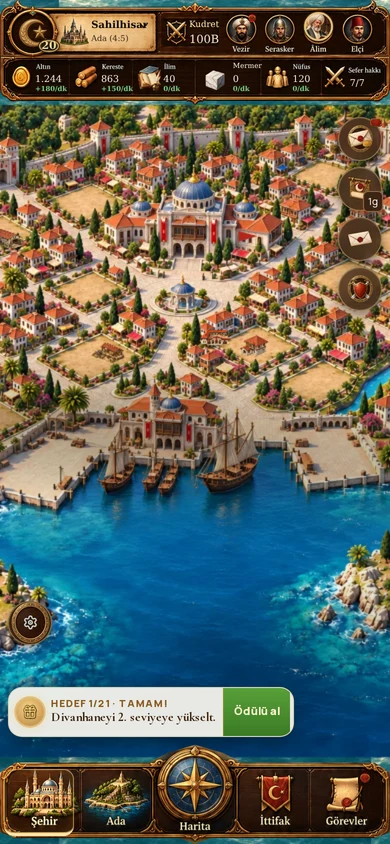
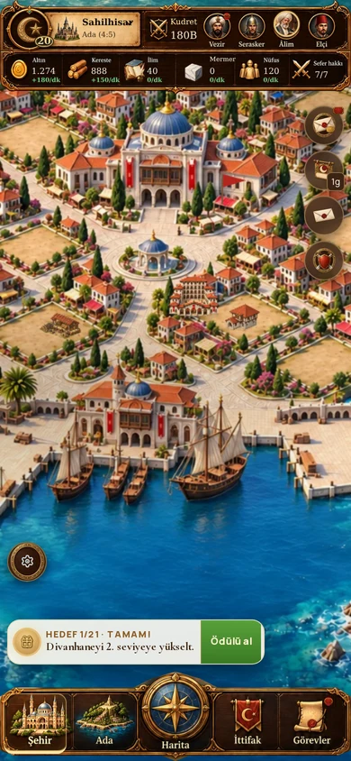

# Şehirle ortak beş aşamalı bina sanatı — ilk aile: Kışla

> 11 Ekim sonraki kullanıcı değerlendirmesi: aşağıdaki bağımsız avlulu aile çevre/arsa uyumu nedeniyle reddedildi. Tasarım standardı olarak kullanılmaz. Yeni çalışma doğrudan gerçek boş araziye göre yapılır: `GLARIUM-PARCEL-FIT.md`. Aşağıdaki teknik kontroller önceki uygulamaya aittir; görsel uyum onayı değildir.

Dal: `prototype/glarium-ottoman-city`. Ana/canlı dal değiştirilmez. Bu çalışma bütün bina aileleri tamamlandı demek değildir: ilk tamamlanan beşli Kışla'dır; diğer aileler önceki üç aşamalı görselleri kullanır.

Yeni şehir, eski üç aşamalı burçlu/isometrik yapıların kamera ve malzeme diliyle aynı değildir. Kışla ilk ortak dil örneği olarak yeniden çizildi: daha önden yükseltilmiş ortografik kamera, açık kireç taşı, kiremit çatılar, ahşap saçaklar, sıcak sol üst ışık; kale mazgalları ve oyuncak blok görünümü kaldırıldı. Beş ayrı şeffaf bitmap asset vardır; yalnız büyütülmüş aynı resim değildir.

| Kışla seviyesi | Kullanılan görsel | Gelişim |
|---|---|---|
| 1–4 | 01 | Alçak L biçimli kanatlar ve basit eğitim alanı |
| 5–9 | 05 | Tamamlanan tek katlı avlu kanatları |
| 10–14 | 10 | İki katlı arka koğuş |
| 15–19 | 15 | Üç katlı koğuş, yükselmiş yan kanatlar |
| 20+ | 20 | Dört katlı merkez, gelişmiş galeriler |

Seçim belediyeden değil **yapının kendi seviyesinden** yapılır. Belediye 20 + Kışla 1, 5, 10, 15, 20 ayrı ayrı gerçek oyunda doğrulandı. Belediye yalnız şehir arka planı aşamasını belirler.

`building-art-growth.ts` ortak eşikleri ve tamamlanmış aile kaydını tutar. Aile yalnız bütün beş görsel hazırsa kaydedilir. `asset.ts` bu kaydı şehir, yapı önizlemesi ve sayfa görselleri için ortak kullanır. Eski `buildingStage` hazır olmayan ailelerde korunur; olmayan dosyalar istenmez. Ekonomi, araştırma, süre, eğitim, maksimum seviye, HUD ve kayıt biçimi değişmez.

## Arsa ve temas

Yasal 2×2 arsa ve kimlik sabittir. İlk iki seviyede yapı bu arsanın %72/%88'ini, ileri aşamalarda ortak temas genişliğini kullanır; büyüme arsa sınırının içinde kalır. Tuvalin şeffaf boşluğu ölçülerek her aşamanın origin ve genişlik oranı ayrı tanımlanmıştır; seviye değişirken ön temas merkezi aynı dünya noktasında kalır. Toprak/çimen/yol görsele gömülmez. Yalnız avlunun yapıya ait iç döşemesi vardır. Temas gölgesini Phaser ayrı çizer. Metadata ölçümleri `GLARIUM-BARRACKS-ASSET-METRICS.json` içindedir.

Assetler `public/images/game/buildings/glarium/kisla-01/05/10/15/20.webp` ve `-sm.webp` varyantlarıdır. Tam boy 768 px, mobil 384 px; bütün dosyalarda gerçek alfa kanalı vardır. Tam boylar 65–136 KB, mobil boylar 22–45 KB'dır. Kaynakların %43–73'ü tamamen şeffaftır. Normalizasyon renk/şekil yeniden çizimi yapmaz; standart çözünürlük ve WebP hazırlanır.

## Üretim yöntemi ve prompt seti

Yerleşik imagegen ile üretildi; onaylı `hall-20.webp` şehir resmi stil/ışık/kamera referansıydı. Önce seviye10 tasarlandı; 1,5,15,20 bu görselin varyantları olarak üretildi.

Ortak istem: “Transparent standalone Ottoman infantry barracks sprite, warm painterly-realistic Ottoman Aegean architecture. Match the supplied city's elevated mostly frontal orthographic camera, ivory limestone, muted terracotta roofs, timber eaves, upper-left daylight and gentle lower-right shade. Clear silhouette at 64–96px. Same centered front entrance and legal ground footprint across the family; additions grow upward. True transparent alpha outside architecture. No landscape, grass, roads, external slab, thick plinth, trees, text, watermark, castle crenellations, crowns, mosque or minarets.”

Aşama istemleri: 1 — modest one-storey L-shaped post with training porch, pennant and spear rack; 5 — one-storey U-shaped post, connected courtyard wings and arched porch; 10 — two-storey rear accommodation block, one-storey side wings, open training courtyard and front arched gate; 15 — three-storey rear block, two-storey side wings, taller formal entrance; 20 — four-storey rear block, three-storey accommodation galleries, complete imperial infantry barracks inside the same legal footprint. İlk aşamanın sonuç görseli ahşap/taş sıvalı L planıdır; kaynak istemdeki “hut” tarifiyle tek küçük ev biçiminde sonuç çıktığı iddia edilmez.

## Kontroller ve sınırlar

351 test geçti. Beş eşik, güvenli geçersiz seviye davranışı, tam/mobil on dosyanın gerçekten bulunması ve ortak önizleme/şehir seçimi test edildi. TypeScript, ESLint, CSS kontrolü, v2 ölçütleri ve üretim derlemesi geçti. `pnpm check` ortamın `tsx` IPC soketi nedeniyle `EPERM` verir; aynı testler `node --import tsx --test` ile tamamlandı.

Genel layout-qa tamamlandı; önceki dal ile aynı 312 küçük dokunma alanı / 664 minik yazı uyarısı nedeniyle başarısızdır. Taşma, kesilme, çakışma, isimsiz kontrol ve sayfa hatası sıfırdır; HUD/sayfa yazıları bu işte değiştirilmedi.

390×844 gerçek oyun sayfasında her Kışla aşaması yüklendi ve dokunuşla Kışla önizlemesi açıldı; önizleme aynı aşama dosyasını kullandı. Belediye her denemede 20 kaldı. Eksik görsel ve JavaScript hatası sıfır. `glarium-barracks/validation.json` kanıttır. Gerçek telefon pil/ısınma ölçümü yapılmadı.

Şehrin belediye/dekor/su/sur resmi hâlâ düzleştirilmiştir. Diğer yapıların kamera, ışık ve footprint uyumunun da beşli ailelerle yeniden üretimi gerekir. Bu ilk aile o işin standardını oluşturur; tüm şehir uyumu tamamlandı veya bütün binalar beş aşamalı oldu diye raporlanmaz.

### Gerçek oyun görüntüleri

Tekrar deneme: çalışan sunucuda `node tools/glarium-building-growth-qa.cjs`. `QA_URL` adresi ve isteğe bağlı `PLAYWRIGHT_CHROMIUM_EXECUTABLE` tarayıcı yolunu belirler; Playwright gerekir.
