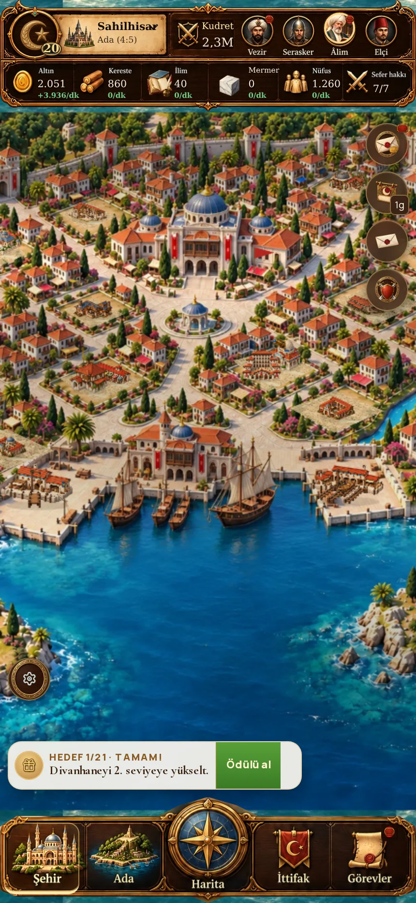
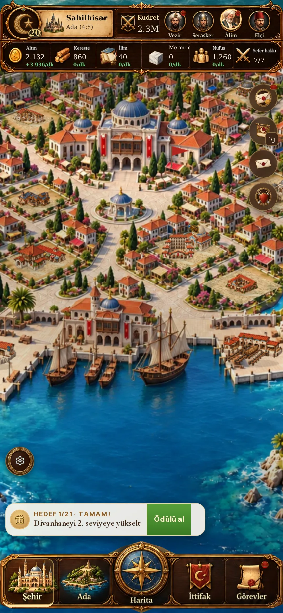

# Gerçek oyunda arsa / bina yerleşimi düzeltmesi

Dal `prototype/glarium-ottoman-city`. Ana/canlı dal değişmez. 11 Ekim kullanıcı geri bildirimi: binalar boş arazide hâlâ doğru oturmuyor ve anlamsız boşluklar kalıyor.

## Değişiklik

Önceki 12 tahmini merkez ve her merkeze uygulanan ±32/±9 ofset kaldırıldı. Gerçek belediye20 tabanında 17 açıklığın dört köşesi sunum katmanına işlendi. Yedi geniş açıklık iki, on küçük açıklık tek kara arsası taşır; toplam 24 kara yuvası aynıdır. Küçük üst açıklıkların zorla ikiye bölünmesi sona erdi. Bölünmüş iki alan ortak sınırı paylaşır; aralarında tanımsız boş şerit bulunmaz. Bunlar elle görsel incelemeyle belirlenen sınırlar; otomatik semantik zemin tespiti değildir.

Motor arsa geometrisi, 0..28 kayıt kimlikleri, bina yerleştirme kuralları, yükseltme, ekonomi, kayıt biçimi ve HUD değişmez. Yalnız resim üzerindeki görünür konumlar değişti. Belediye, kıyı ve korsan konumları korunur.

Kurulu kara yapısında arsa poligonu içine kırpılmış ortak avlu katmanı çizilir. Belediye1/5'te toprak; 10/15/20'de mevcut açık taş dokusu. Taş yönü arsanın iki eksenine dönüşür. Genel yol/çiçeklik/ağaç bina dosyasına gömülmez. Avlu giriş yaklaşımı alt arsa kenarına uzanır; avlu bütün yapı sprite'larının altında durur. Boş arsa inşa edilmeden döşenmez.

Şehir resmi için şeffaf dosya kenarları artık bina büyüklüğünü belirlemez. En fazla256px alfa örneğinden görünür sınır ölçülür; şehrin geçici doku tuvali bu sınıra göre kırpılır ve yumuşak filtrelenir. Kaynak dosya ve UI görselleri değiştirilmez. Kara yapısının ortak görünür genişliği60 dünya pikseli; Kışla erken aşamalarında mevcut0.72/0.88 büyüme oranı korunur. Görünür alt orta noktası zemine bağlanır; eski genel0.88 origin ve Kışla'ya özel tuval-padding oranı şehirde kullanılmaz. Bu görünür sınır normalizasyonudur; bütün bina türlerinin fiziksel tabanını tek başına ölçmez.

Boş arsa ve dolu arsanın zemini gerçek poligonla dokunma alır. Bina üst bölümü alfa hassas dokunma alır; komşu arsanın üstüne taşan görünmez dikdörtgen hedef kaldırıldı. Taşıma önizlemesi aynı poligonu kullanır.

## Kontroller

355 test geçti. Yeni testler kayıt kimliklerini, 17 açıklığın 24 arsaya alan kaybı olmadan dağılımını, poligon içlerinin birbirine girmemesini ve şeffaf sınır normalizasyonunu doğrular. TypeScript, ESLint, CSS, üretim derlemesi ve v2 ölçütleri geçti.

`pnpm check` bu ortamda `tsx` IPC soketindeki `EPERM` nedeniyle test başlangıcında durur. Aynı testler `node --import tsx --test` ile çalıştırıldı. Genel layout-qa önceki gibi 312 küçük hedef / 664 minik metin nedeniyle başarısız; taşma, kesilme, çakışma, isimsiz kontrol ve sayfa hatası sıfır. Bu HUD uyarıları bu değişiklikte ele alınmadı.

Gerçek oyun sayfası 390 ve430px'de belediye1/5/10/15/20 ile denendi. Belediyeye dokunma, boş arsa açma, Kışla taşıma önizlemesi ve onayı geçti. Kışla'nın beş kendi seviyesi de belediye20'de ayrı ayrı denendi; doğru şehir/önizleme görseli açıldı. Dolu şehir örneğinde bütün24 kara yuvası, belediye ve üç kıyı/ada yapısı toplam28 yerleşim olarak beş gelişim aşamasında çizildi. Eksik görsel ve tarayıcı hatası sıfır. Büyük ekran taşma denetimi geçti.

Son taş yönü/zemin katmanı değişikliğinden sonra dolu şehir beş aşamada yeniden görüntülendi. Önceki dokunma/taşıma kontrolü aynı poligon ve girdi koduyla yapılmıştır. Kanıt: `glarium-parcel-runtime/validation.json`; çalıştırma `node tools/glarium-parcel-fit-qa.cjs`.

## Açık sınır

Bu çalışma mevcut görsellerin yerleşimini düzeltir. Önceki Kışla aile çizimi kullanıcı tarafından reddedilmişti; eski diğer bina aileleri de yeni kimlik levhasına henüz dönüştürülmedi. Yeni onaylı tür siluetleri/şeffaf beşli aileler ayrıca üretilmelidir. Bu örnek 24 farklı kara binasını aynı anda denedi; katalogdaki bütün ailelerin bütün arsalar × bütün seviyeler kombinasyonunu veya gerçek oyuncu tanıma testini kapsamaz. Düzleştirilmiş arka planın dekor/evlerinin gerçek 3D occlusion bilgisi yoktur. Bütün şehir sanatının uyumu tamamlandı diye sunulmaz.

