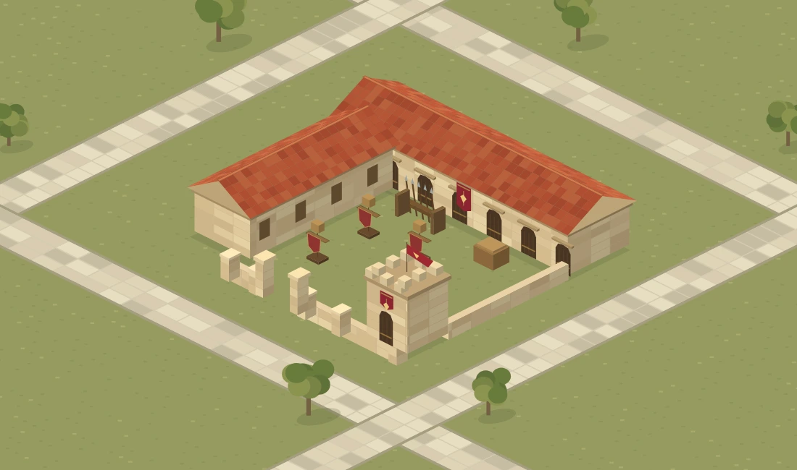
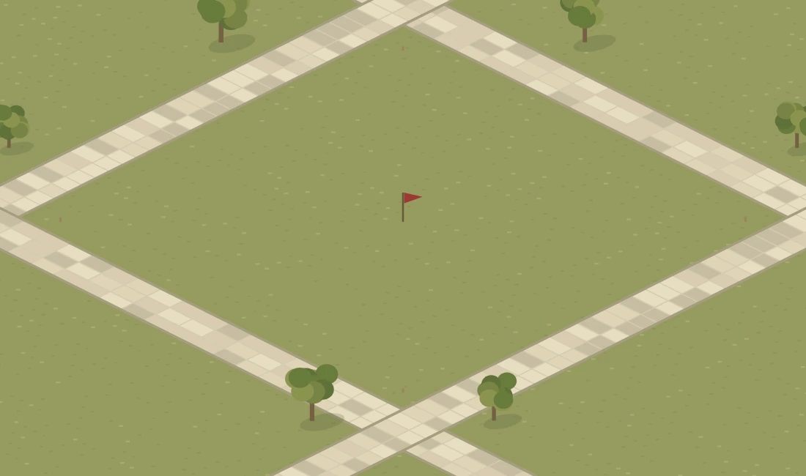
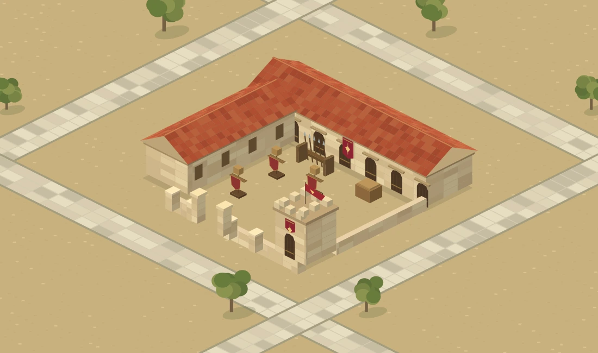

# Ikariam incelemesi ve tek kışlalık prototip

16 Ekim 2026. Kullanıcı önce Ikariam'ın karo, arka plan ve bina çizimlerini incelemeyi, sonra prototip hazırlamayı istedi. Önceki 0.111.3 kışla sonucu reddedildi. Projektif resim esnetmesi teknik olarak sınır içinde kalsa da kullanıcı için görsel uyum sağlamadı. O sürüm onaylı tasarım değildir.

## İncelenen kaynaklar

- [Gameforge'un Ikariam sayfası ve resmî ekran görüntüleri](https://gameforge.com/en-GB/play/ikariam).
- [Resmî şehir ekranı](https://secure-asset-delivery.gameforge.com/partnersite_live_product/6a171b2f-0bf8-476e-9f99-fd0c8046fe9b/YWRoi79TPigWK6VzFikxpEUdfIzcRK3klQcQ8ZV4.jpeg).
- [Boş arsalar ve belediye penceresi](https://secure-asset-delivery.gameforge.com/partnersite_live_product/6a171b2f-0bf8-476e-9f99-fd0c8046fe9b/iIHpCZHnzwRRcAAARRu8swpzGL4VCQVDXaTmorUK.jpeg).
- [Kışla penceresi ve aynı şehir çevresi](https://secure-asset-delivery.gameforge.com/partnersite_live_product/6a171b2f-0bf8-476e-9f99-fd0c8046fe9b/YLlQ9FQ14dYEUMvhYoliiKTtv9IPK5DyLAn1TIiT.jpeg).
- [2010 tarihli resmî şehir görüntüsü / JeuxOnLine](https://www.jeuxonline.info/image/33968/captures-officielles-03).

Aramada Ikariam diye etiketlenmiş bir Age of Empires Online görüntüsü de çıktı; üzerindeki oyun logosundan ayırt edilip referanslardan çıkarıldı. Ikariam görselleri prototipe asset olarak kopyalanmadı.

## Görsellerden çıkarılan tasarım ilkeleri

Bu bölüm ekran görüntülerinin görsel incelemesidir. Ikariam'ın kapalı kaynak motoru, gerçek kamera parametreleri veya sprite kodu incelenmiş gibi bir iddia yoktur. Seçilen 2:1 sayısal projeksiyon bizim prototip kararımızdır.

| Konu | Görsel gözlem | Prototipte karşılığı |
| --- | --- | --- |
| Arsa ve yollar | Şehir içinde yollar ve bina tabanları tutarlı çapraz eksenler izliyor. Her arsa için başka perspektif görünmüyor. | x=(28,14), y=(-28,14), z=(0,-28); bütün çizim aynı kameradan. |
| Boş arsa | Çayır üzerinde hafif sınır/köşe işaretleri ve bayrak var. Büyük opak bina zemin kartı izlenimi oluşmuyor. | Bina kaldırılınca mevcut arazi ve hafif köşe işaretleri görünür. |
| Çevre | Arazi, yollar, kıyı, bitki örtüsü şehrin sürekliliğini kuruyor. | Bu ilk kesitte ortak arazi ve yollar var; kıyı ve bütün şehir henüz üretilmedi. |
| Bina tabanı ve yüksekliği | Görünen çatı/duvar hacmi ile zemindeki temas alanı ayrı düşünülmeli. | Model (x,y,z) olarak çiziliyor. Yükseklik de parselin içinde yer tüketiyor. |
| Bina kimliği | Kütle, çatı/kubbe, işaret ve eşya düzeni değişiyor. Türler aynı avlu şablonunun kopyası gibi görünmüyor. | Tek kışlada L koğuşu, nöbet kulesi, askerî sancak, mızrak rafı ve talim hedefleri. Diğer bina türleri bu işte yapılmadı. |
| Çizim ölçeği | Küçük ölçekte büyük kütle ve kontrast, ince ayrıntıdan önce okunuyor. | Alçak koğuş, tek belirgin kule ve bordo askerî vurgular. Son boyalı çizim henüz yok. |

Mevcut unified-detail-v3 ise farklı oranlarda yatay trapez arsalar içeren bir resim. Tek bir çapraz kamera kullanan bu prototip onun üzerine yapıştırılmadı. Ana oyunla bütünleştirme, mevcut arka planı aynı geometriyle yeniden hazırlamayı veya mevcut arka planın gerçek kamera kurallarına uygun ayrı bir model kurmayı gerektirir. Prototip ana oyun hatasını çözmüş sayılmaz.

## Çalışan prototip

[Prototipi aç](https://ashina61.github.io/gameofashina/ikariam-study.html).

- Boş arsa / Kışla: aynı arazi üzerinde yalnız mimari değişir.
- Karo çizgileri: gerçek 12×12 arsanın ve alt karoların izdüşümü.
- Toprak zemin: ortak şehir arazisi çayırdan toprağa döner; avlu da birlikte değişir.
- Çevreyi gör: komşu boş arsaları ve yol ağını gösterir.
- İlk görünüme dön: bütün seçimleri başlangıca alır.

Kaynak: `public/ikariam-study.html`, `public/prototypes/ikariam-study-v1/renderer.mjs`. Bina bir raster resim olarak sığdırılmaz. Duvar, çatı ve eşyalar dünya koordinatlarından Canvas yüzeyleri olarak çizilir; mimarinin parçası olan zemin yüzeyi yoktur. Önceki master-cutout-quad kodu bu prototipte kullanılmaz. Bu bir geometri ve yerleşim prototipidir; sanat kalitesi son boyalı oyun çizimi değildir.

Ana oyun, sürüm numarası, servis çalışanı, HUD, ekonomi, kayıtlar ve arsa kimlikleri değişmedi. Önceki yayın yetkisiyle prototip ayrı bir URL'de sunulur.

## Görsel kanıt ve doğrulama

`docs/mockups/ikariam-study/` içindeki görüntüler **native Canvas çıktılarıdır; tarayıcı ekran görüntüsü değildir.**

`NODE_PATH="$CODEX_PRIMARY_RUNTIME_NODE_MODULES" node tools/ikariam-study-qa.cjs`:

- 1.048 yüzey / 4.213 mimari köşe, yüksekliği hesaba katarak aynı arsa izdüşümü içinde.
- 360, 390, 430 ve 1100 px genişlik; çayır ve toprak toplam sekiz native render durumu.
- Her durumda arsa dışındaki değişen piksel 0. Bu, çevredeki yolları da kapsar.
- Her durumda açık avluda 36 örnek piksel, binasız araziyle aynı.
- Arazi yüzeyi mimari modele eklenirse kontrol başarısız olur.

Bu kontroller geometri ve katman davranışını ölçer; estetik kabul anlamına gelmez. Mobil ölçekte native görüntü ayrıca incelendi. Canlı tarayıcı etkileşim kontrolü bu teslimde yapılmadı. Yönetilen ortamda control-browser becerisi bulunmadığı için önizleme sunucusu veya alternatif otomasyon başlatılmadı; genel layout-qa da yeniden çalıştırılmadı. Ana oyunun daha önce kaydedilmiş düzen sonuçları bu prototipe ait sayılmadı.

`pnpm check` geçti: tip kontrolü, 360 test, ESLint ve CSS kontrolleri. V2 ölçütleri ve iki JavaScript sözdizimi kontrolü geçti. Genel layout-qa yukarıda belirtilen nedenle yeniden çalıştırılmadı. Yayın GitHub Pages Deploy işinin başarılı sonucuyla doğrulanır.
