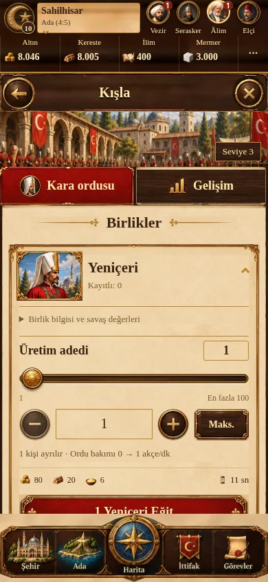
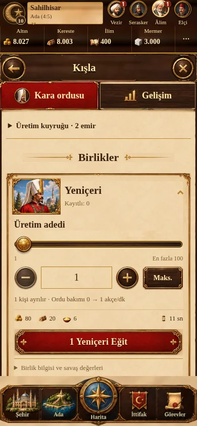
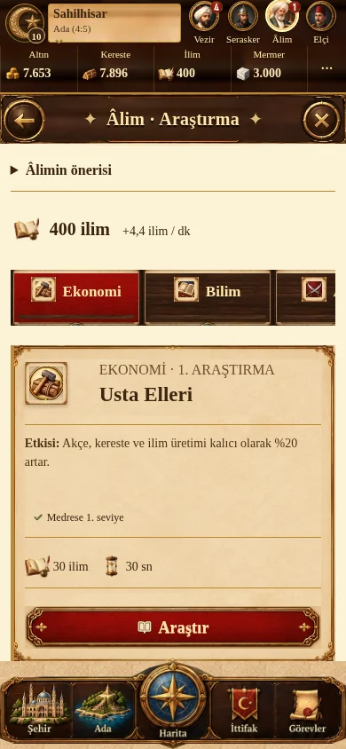
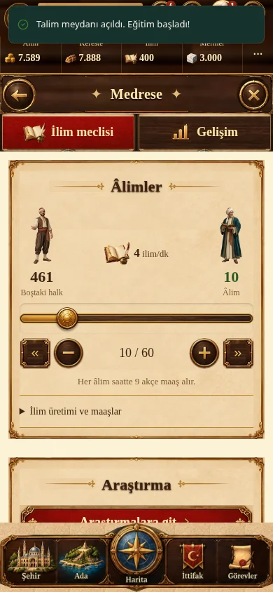

# Bina yönetiminde işlem sırası — 0.133.0 / SW158

21 Kasım 2026. Ana ekranın 0.132 sadeleştirmesinden sonra Kışla, Medrese, Araştırma ve üretim yapılarının içerik sırası düzenlendi. Mevcut boyalı portreler, atlaslar, adet/işçi kontrolleri ve HUD korunur.

## Kışla ve eğitim

Üretim kuyruğuna uzun birlik listesinin üstündeki tek satırdan ulaşılır. Boş/dolu durum gerçek emirlerden türetilir; açıldığında mevcut portre, ilerleme, kalan süre ve bekleyen emirler korunur. Yeni iptal veya sıra kuralı yoktur; mevcut emir sınırı kullanılır.

Seçili birlikte önce adet ve gerçek maliyet/süre, halk ve bakım etkisi, ardından eğitim düğmesi gelir. Açılır savaş bilgisi bu işlemin altındadır. Aynı adedin üçüncü kez gösterildiği salt okunur kutu kaldırıldı; gerçek sayı alanı, sürgü, +/− ve Maks. durur. Dikey birlik seçimi ve asker çizimleri değişmez. Ortak eğitim bileşeni Tersane ve ordu sicilinde de aynı sıra erişimini sağlar.

## Medrese ve araştırma

Medrese doğrudan âlim atamasıyla açılır. Araştırmaya geçiş düğmesi araştırmanın kendi bölümündedir; atama kontrolünden önce yer kaplamaz.

Araştırma defteri ilk bakışta mevcut ilmi ve dakikalık üretimi gösterir. Dört ayrıntılı âlim/ilim/maaş satırı “Âlimler ve maaşlar” altında korunur. Seçilen araştırmanın etkisi karar düğmesinden önce okunur. Listeden farklı bir konu seçilince seçili konu kartı doğrudan görünür yere gelir; klavye odağı da karta taşınır. Uzun liste boyunca kaydırma animasyonu oynatılmaz.

Bir araştırma sürerken ilerideki konuların kilit işaretlerinin kaybolması düzeltildi. Görsel kilit hesabı devam eden işi ayrı tutarak aynı motor gereksinimlerini okur; emir düğmesi gerçek `researchReason(game, id)` koşullarını kullanmayı sürdürür. Gereksinimler ve ilim/iş maliyeti değiştirilmedi.

## Üretim

Toplam üretim, stok, yapı katkısı ve kahvede net stok değişimi görünür kalır. Ada kaynağı/orman, Ambar ve kahve yönetimi bağlantıları ayrıntılı muhasebeden önce gelir. İşçi sayıları, çarpan öncesi orman katkısı, tüketim ve boş yer “Üretim hesabı ve çalışanlar” altında okunur. Dolu stok ve yanlış kaynak adası uyarıları bu kapalı bölümün dışında kalır.

Kışla, Medrese ve altı üretim yapısının ortam çizimleri Gelişim sekmesinde korunur. Yükseltme o sekmede ilk işlem olmaya devam eder; ortam bandı açıklama ve yapı işlemlerinden önce, seviye etkisi/öngörülerinden sonra gelir. Seviye galerisi eklenmedi. Yönetim sayfalarının altında opak parşömen rengi bulunur; kâğıt varlığı yüklenirken şehir metnin arkasından görünmez.

## Gerçek ekranlar

Aynı örnek kayıt, 390×844 ekran; derlenmiş oyun. Önce kaydı 0.132 dışa aktarımındandır. Yeni konsept görseli değildir.

## Doğrulama

- 396 otomatik motor/sunum testi; TypeScript, ESLint/CSS ve V2 bütçeleri.
- `tools/management-clarity-qa.cjs`: 29 derlenmiş senaryo geçti. 360/390/430 ekranlarında ilk işlem erişimi; gerçek eğitim emri ve motorun sıra sınırı; işçi taslağı/geri alma/onay; Gelişim’de önce yükseltme; araştırmanın gerçek ilim harcaması, devam eden iş ve kilitli konular; büyük yazı, dolu stok ve yanlış ada uyarıları. Eksik varlık ve sayfa hatası yok; ölçümler `docs/mockups/management-0133/after.json` içindedir.
- Son Android statik derlemesi ve telefon varlık hazırlığı. Tam 360×740/%130 arayüz taraması sıfır taşma, kırpılma, küçük hedef/yazı, çakışma, adsız kontrol ve sayfa hatası verdi; `layout-report.json` ile kayıtlıdır.

Bu değişiklik sunum ve etkileşim sırasıyla sınırlıdır. Ekonomi, inşa/eğitim/araştırma süreleri, kayıt şeması, şehir ve ada koordinatları değişmez. Fiziksel Android ve imzalı APK/AAB doğrulaması yapılmadı. Diğer yönetim ekranlarının ve bütün sanat kataloğunun kullanıcı kabulü tamamlanmış sayılmaz; inceleme sürümüdür.
