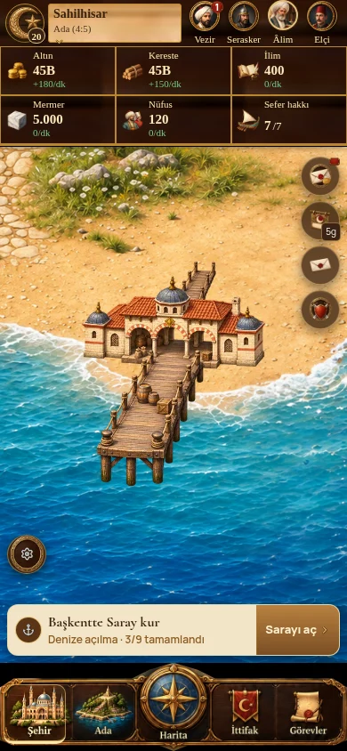
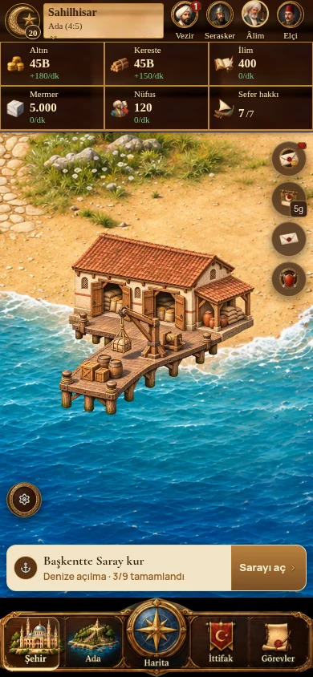
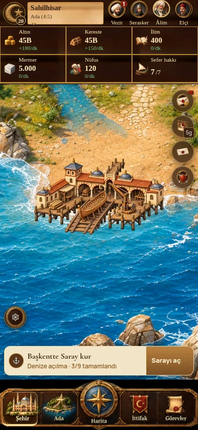
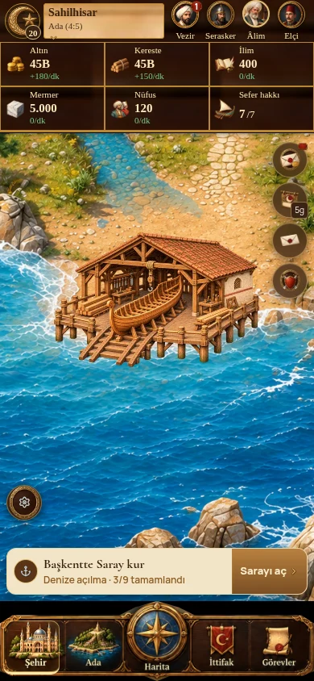

# Kıyı yapıları — 0.130.0 / SW155

18 Kasım 2026. Liman ve Tersane, üretim binalarıyla aynı ahşap/taş/çatı dilinde yeniden çizildi.

## Sonuç

- Ticaret Limanı: alçak gümrük deposu, yükleme sundurması, görünür ahşap vinç, sandık ve fıçılar. Tek ön iskele denize uzanır.
- Tersane: açık ahşap atölye, görünen çatı makasları, yarım tekne gövdesi, inşa kızağı ve halatlı makara. Limanın kapalı deposu bu türe kopyalanmaz.
- İki türün yan ve düz yönleri ayrı çizimlerdir. Sağ yön mevcut aynalama komutuyla çalışır. Eski kubbeli cepheler ve çatının arkasından çıkan gereksiz köprü/iskeleler kaldırıldı.
- Bütün çevre ve kazık araları gerçek alfadır. Ahşap rıhtım ve çalışma güvertesi mimarinin parçasıdır; çizimlere deniz, kıyı, toprak veya yeni arsa zemini gömülmez.
- Kaynak oranı korunur. Yeni çizimlerden ölçülen temas noktası mevcut boyalı kıyıya hizalanır; çizimlerin tamamı sabit kıyı arsasına sığdırılır. Yeni arsa, yol veya şehir zemini eklenmez.
- Şehir, bina önizlemesi, inşa kataloğu, açılış dekoru ve ilgili görev görselleri yeni kıyı ailesini kullanır. Onaylı HUD korunur.
- Yapı seviyeleri, sefer süreleri, üretim/ekonomi ve kayıt biçimi değişmez.

## Dosyalar

`public/images/game/buildings/parcel-v9/` içinde `liman`, `liman-duz`, `tersane`, `tersane-duz` için full/telefon WebP çiftleri bulunur. `maritime-art-provenance.json` üretim yöntemini, tam istemleri, kaynak SHA-256 değerlerini ve dosya yollarını kaydeder. Yeniden paketleme aracı `tools/art/prepare-maritime-art.cjs` dosyasıdır; renk, oran veya alfa yeniden boyanmaz.

## Doğrulama

- 390 otomatik test geçti. TypeScript, ESLint ve CSS kontrolleri tamamlandı.
- Mevcut alfa testleri dört çizimi full/sm, üç kıyı arsası ve iki yansıma yönünde denetler. Kaynak alfa sınırları, oranlar ve temas pinleri korunur; gerçek arazi pikselleri kıyı ve su yönünü ayrıca doğrular.
- Gemi çıkışı testleri, yeni liman silüetinin gerçek ucundan başlayan hareketi ve gövde örneklerinin boyalı su üzerinde kalmasını denetler.
- `tools/maritime-city-qa.cjs`: derlenmiş Android dışa aktarımında 13 senaryo geçti. İki yapı da 25/26/27 arsalarında sol/sağ/düz yönlerde yüklendi, bina dokunuşları doğru paneli açtı. 360/390/430 genişlikleri ve her iki türde yeniden yüklemeden sol → düz → sağ → sol yön döngüsü denetlendi. Eksik görsel ve sayfa hatası bulunmadı.
- Tam arayüz taraması 360×740 ve %130 metinde taşma, kırpılma, küçük hedef, küçük yazı, çakışma, adsız kontrol ve sayfa hatası bulmadı.
- Android statik derlemesi ve telefon görsel hazırlığı geçti. Küçük bina görselleri 13,7 MB / 15 MB sınırı içindedir.

## Gerçek oyun ekranları

390×844 tarayıcı, örnek şehir kaydı, derlenmiş oyun. Aynı kıyı arsaları ve kamera kullanıldı.

## Açık kapsam

Bu bölüm iki kıyı yapısını kapsar. Diğer binaların bütün seviye çizimleri ve genel şehir için kullanıcı görsel kabulü tamamlandı sayılmaz. Fiziksel Android cihazında GPU/pil testi ve imzalı APK/AAB doğrulaması yapılmadı.
