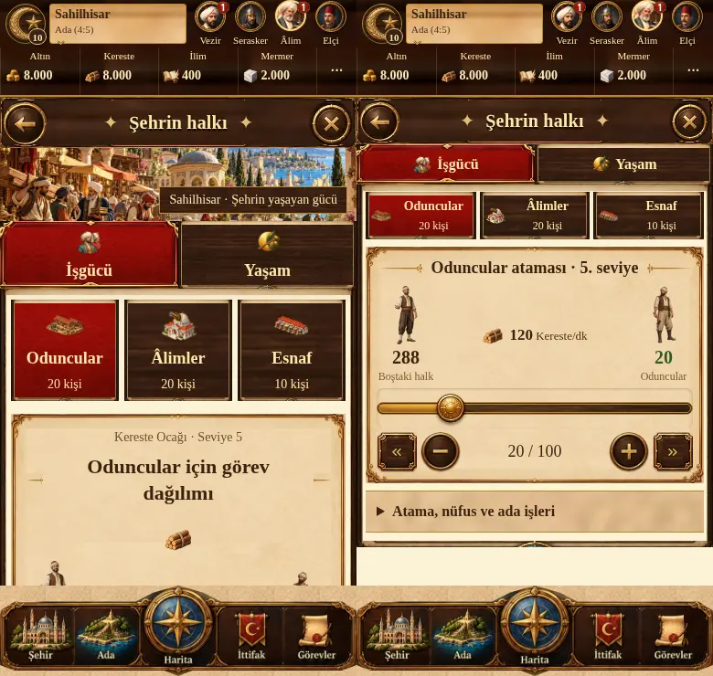
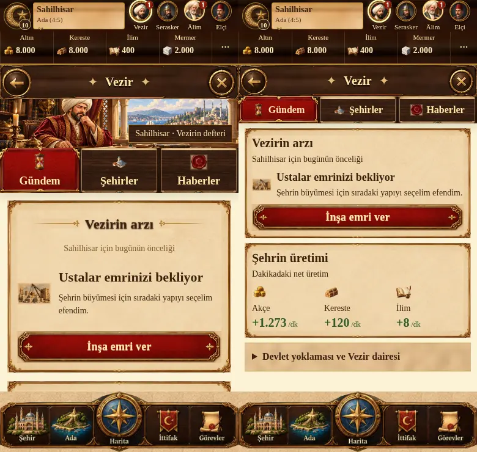
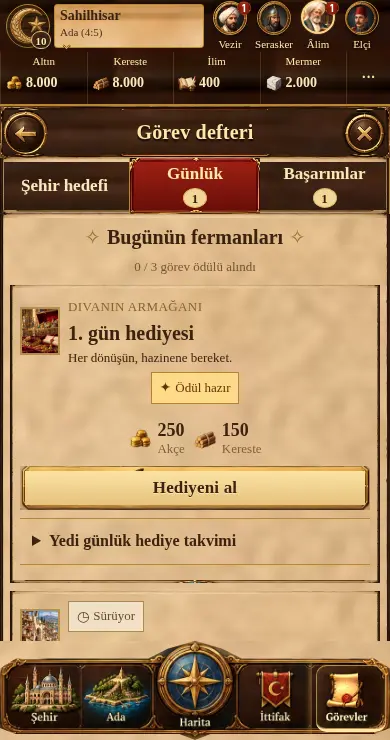

# Mobil sayfa düzeni — 0.137.0

23 Kasım 2026 · SW162

Kullanıcı oyunun görsel düzenini ve sayfalarını mobil oyun geliştiricisi gözüyle incelememizi, gerektiğinde yeniden tasarlamamızı istedi. Önceki sürümün Hazine düzeni başlangıç noktasıdır. Bu çalışma ana kararları görünür kılar; uzun listelerin tamamını küçülterek tek ekrana sıkıştırmaz.

## Gerçek oyun incelemesi

Derlenmiş oyunda 390×740 görünümde 19 ana sayfa ve 10 ek sekme durumu kaydedildi. `tools/mobile-design-audit.cjs` aynı kayıt ve saatte önce/sonra ekranları ile kaydırma ölçümlerini üretir. Her durumdaki motor verileri aynıdır. Bu tarama bütün bina/oyuncu durumlarının eksiksiz görsel kabulü değildir.

| Sayfa | Bulgu | Yeni düzen |
|---|---|---|
| Halk / İşgücü | Sahne, büyük meslek kartları ve tekrarlanan başlıklar atama onayını aşağı itiyordu. | Meslekler kısa seçimlerdir. İşçi, boş halk, üretim önizlemesi ve onay birlikte; nüfus açıklaması ve ada bağlantıları açılır. |
| Halk / Yaşam | Uzun nüfus açıklaması, şehir yaşamını geliştiren yapıları gizliyordu. | Nüfus/barınma/huzur ve büyüme önce; yapı bağlantıları ardından; ayrıntılı hesap ayrıca açılır. |
| Ada ormanı / maden | Sahne ve üç büyük bilgi satırı işçi kontrolünden önce geliyordu. | Seviye, görevli/kapasite ve gerçek üretim atamanın yanında. Dolu stok uyarısı açıkta; hesap ve sahne ayrıntıda. |
| Vezir | Boş inşaat iki kartta tekrarlanıyor, üretim çok aşağıda kalıyordu. | Öncelik ve eylem, varsa aktif inşaat, üç kaynak üretimi. Devlet yoklaması ayrı açılır. |
| Şehirler | Büyük yerleşim kartları ve sahne yeni koloni / nakliye kararını geciktiriyordu. | Kısa yerleşim listesi, önce işlemler. Nakliye kaynağı/miktarı yan yana; uyarılar korunur. |
| Görevler | Günlük hediye takvimden sonra; kilitli başarımlar büyük resimli kartlardı. | Hediye önce alınır. Hazır günlük görevler üsttedir. Hazır başarım açık; diğerlerinin ayrıntısı isteğe bağlıdır. |
| Şehir hedefi | Tamamlanmış kurucu kayıtları koloni planını uzatıyordu. | Koloni planı ve kurucu defter ayrılır. Bitmemiş kurucu ferman ve ödülü önceliklidir; koloni yolu ayrıca açılır. Kurucu görevler bitince koloni planı öne geçer. Yeni oyuncu mevcut fermanı doğrudan görür; ferman seçimi ilgili karta odaklanır. |
| Ayarlar / Serasker | İşlevsiz ortam resmi kontrollerin önünde yer kaplıyordu. | Kontroller/kayıtlar önce, ortam sahnesi sayfanın sonunda açılır. |
| Ortak sekmeler | 74px resimli sekmeler ve önceki sekmeden kalan kaydırma kararları saklıyordu. | 44px ve üzeri yatay resim/etiket, sekme değişiminde başa dönüş; klavye gezinmesi korunur. |
| Hazine | 0.136 ana özetleri zaten kısaydı. | Önceki tek görünüm ve yedi kaynak akışı regresyonla korunur. |
| Harita / Profil | Harita ve hükümdar kimliği bu sayfaların ana içeriğidir. | Anlamlı ana çizimler korunur. Mekânsal harita, kamera ve şehir geometrisi bu çalışmada değiştirilmez. |
| Ordu / Araştırma / İnşa / Elçi / İttifak / Günlük / Özet / Sürümler | İlk kararın yeri ve ortak yoğunluk incelendi. | Ortak sekme ölçüsü uygulanır; mevcut ayrı yönetim akışları sürer. Bütün alt durumlar yeniden tasarlanmış sayılmaz. |

## Gezinme düzeltmesi

Şehir idaresinde bir onayı açıp başka sekmeye geçince bekleyen başkent taşıma / terk etme onayı temizlenir. Bu testte gerçek şehir silme veya başkent taşıma uygulanmaz. Ortak sekmeler derin açıklama kaydırmasını devralmaz. İşçi taslağı kaynak harcamaz, Geri al kayıt yazmaz, yalnız Onayla gerçek komutu çalıştırır.

## Doğrulama

- Gerçek statik oyun: 360, 390 ve 430×740; ana işçi ataması ve değişiklik onayı ilk görünümde.
- Üç şehir mesleği, orman/maden ataması: deneme, geri alma, gerçek kayıt sonucu.
- Günlük hediye ve başarım: hazır eylem görünür, bir kez ödeme; günlük görev sıralaması ve kalıcı talep durumu.
- İki şehir arasında gerçek 100 kereste nakliyesi, kaynak düşümü ve gönderi kaydı.
- Şehir idaresi onayını sekme değişiminde temizleme, kurulu olmayan işyeri, yeni oyuncu hedefi ve ferman seçimi.
- %130 yazı: doğal kaydırma ile erişim, yatay taşma olmaması; içerik kırpma ve zoom kullanılmaz.
- Hazine regresyonu: üç telefon boyutu, yedi kaynak, dolu/boş stok, büyük rakam/yazı ve gerçek yapı bağlantısı.

Tekrarlanabilir araçlar: `tools/mobile-page-qa.cjs`, `tools/mobile-design-audit.cjs`, `tools/treasury-overview-qa.cjs`, `tools/layout-qa.cjs`. Son ölçümler ve gerçek ekran örnekleri `docs/qa/mobile-0137/` içindedir.

Fiziksel Xiaomi/Android WebView denemesi bu ortamda yapılmadı. Tarayıcı emülasyonu fiziksel cihaz, genel bina sanatı veya mağaza yayını kabulü sayılmaz. Şehir sanatının tamamı yeniden çizilmedi; bu sürümün kapsamı sayfa hiyerarşisi ve kullanım düzenidir.

## Son ölçüm

Aynı 390×740 kayıt, normal yazı; kapalı açıklamalarda ek kaydırma:

| Ana görünüm | Önce | Sonra |
|---|---:|---:|
| Halk / İşgücü | 857px | 0px |
| Vezir / Gündem | 945px | 0px |
| Ada ormanı / Üretim | 208px | 0px |
| Görevler / Şehir hedefi (kurucu görevler bitmiş) | 541px | 0px |

Bu rakamlar işçi taslağı açılmadan varsayılan ekran içindir. Ayrıca üç genişlikte değişiklik onaylarının da ilk görünümde olduğu doğrulandı. Uzun görev/başarım listeleri kaydırılır; listenin bütününü tek ekrana sığdırma iddiası yoktur.

[29 ekranın önceki ölçümü](qa/mobile-0137/before.json), [yeni ölçüm](qa/mobile-0137/after.json), [34 etkileşim senaryosu](qa/mobile-0137/decisions.json), [genel arayüz sonucu](qa/mobile-0137/layout.json), [Hazine regresyonu](qa/mobile-0137/treasury.json).

397 otomatik test ve TypeScript, ESLint, CSS/kullanılmayan sınıf, V2 ölçütleri geçti. Statik Android derlemesi ve telefon varlık hazırlığı tamamlandı. Genel arayüz taraması 360×740 normal ve %130 yazıda taşma, kesik yazı, küçük hedef, minik yazı, çakışma, isimsiz kontrol ve sayfa hatası toplamlarını sıfır buldu.

Aşağıdaki yan yana gerçek oyun ekranlarında solda önce, sağda sonra:

