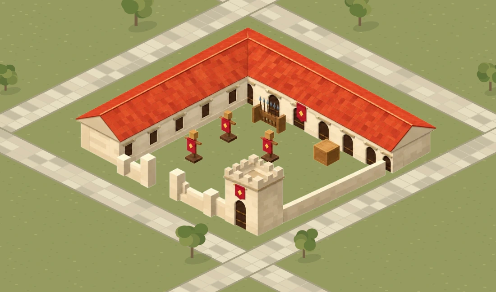
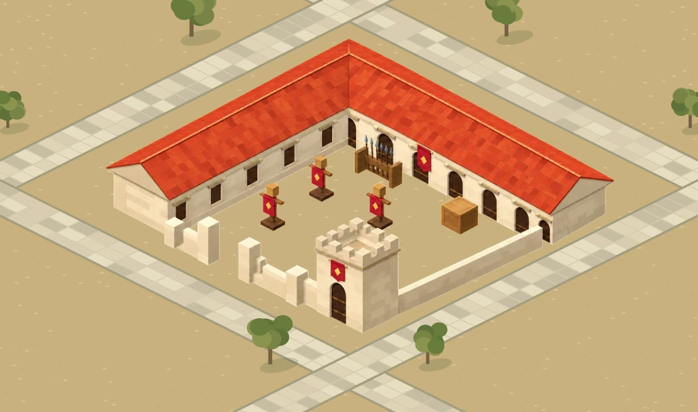

# Boyalı kışlanın çalışan arsa sahnesi

17 Ekim 2026. Kullanıcı zeminsiz kışlanın arsa üzerindeki görsel önizlemesini gördükten sonra “şimdi bunu gerçeğe dökelim” dedi. Bu kayıt, tek kışlalık çalışan arsa sahnesine gerçek alfa varlığını bağlayan uygulamadır.

## Uygulama

`/ikariam-study.html` artık geometrik kışla yerine `public/images/game/buildings/parcel-v1/kisla.webp` dosyasını yükler. Bina, yollar ve arazi ayrı katmanlardır. Önizleme kompozisyonunun tamamı arka plana yapıştırılmaz. Binanın avlusu, kapı açıklığı ve eşya araları gerçek alfa ile açık kalır. Çayır/toprak düğmesi bütün ortak araziyi değiştirir; ayrı bina zemini veya döşemesi eklenmez.

`public/prototypes/ikariam-study-v1/art.mjs` son WebP'nin alfa konturundan ölçülen yerleşimi saklar. Kaynak pikseli kameranın iki zemin eksenine ters izdüşürülür; aynı ölçek her iki görüntü ekseninde korunur. Kaynak 1024×605; dünya çerçevesi sol=-328.64, üst=-25.6, genişlik=655.36, yükseklik=387.2. Her iki eksende katsayı 0.64. Projektif UV, yamultma veya kırpma yoktur. En yakın görünür kenar, 12×12 arsanın 0.12 birim içindedir.

Tam varlık ve telefon boyu kardeşi `parcel-v1/kisla.webp` ile `kisla-sm.webp` altında bulunur. Paketleme sırasında PNG WebP'ye çevrildi, alfa kalitesi korundu; yalnız 8/255 altındaki görünmez alfa gürültüsü atıldı. Çizim veya zemin kodla yeniden boyanmadı. Onaylanan kompozisyondan mimari ayırma işlemi yerleşik image_gen ile yapıldı.

Yükleme tamamlanmadan kışla düğmeleri açılmaz; hatada açık hata metni gösterilir. Çalışan kontroller: Boş arsa/Kışla, Karo çizgileri, Toprak zemin, Çevreyi gör, İlk görünüme dön. Kaynak kodu `renderer.mjs` içinde tarihî geometrik taslağı tutar; canlı sayfa yüklenen varlığı kullanır ve yükleme hatasında eski çizime sessizce dönmez.

Bu URL yeni ortak kamera üzerinde tek bina denemesidir. Ana oyunun eski yatay trapez arka planına bu bina esnetilmedi. Ana şehir sahnesi, oyun kayıtları, ekonomi ve HUD bu değişiklikte aynı kalır. Bütün şehir veya diğer bina türleri tamamlandı iddiası yoktur.

## Çizim kaynağı ve son prompt

Yerleşik image_gen, `background-extraction`, `transparent_background=true`; referans, kullanıcının arsa üzerinde gördüğü son kompozisyondur. Kaynak üretim dosyası `exec-3ce48623-fcac-45af-a33d-f6d0896c81b3.png`.

Son prompt:

> Use case: background-extraction. Extract ONLY the complete barracks architecture and its military props from this approved in-context preview into a genuinely transparent PNG game asset. Preserve the exact building drawing, roof silhouette, wing lengths, camera, colors, tower, front walls and open entrance, banners, three training dummies, spear rack and crate. Keep every building and prop at the SAME pixel position and scale as in the supplied image; keep the original full landscape canvas and transparent margins, do not zoom or recenter. Remove every pixel of the landscape: all green grass INCLUDING THE ENTIRE COURTYARD, all ground speckles, roads, trees, tree shadows and other environment. No ground shadows; retain only shading painted on the architecture itself. Every courtyard gap and prop gap must be actual alpha transparency. No soil, grass, paving, floor, plinth, platform, slab or diamond tile. Clean antialiased alpha edges without any grass halo or stray pixels. Do not redesign or add architecture; do not change perspective or framing. The final image must be just the original building and props floating on true transparency, ready to overlay on the unchanged game terrain at the same position. No text, UI, outlines, checkerboard pattern or watermark.

## Doğrulama

`NODE_PATH="$CODEX_PRIMARY_RUNTIME_NODE_MODULES" node tools/ikariam-study-qa.cjs` gerçek son WebP'yi ve sayfanın renderer modülünü kullanır:

- 190.109 görünen pikselin tamamı yüksekliği de kapsayan arsa izdüşümü içinde.
- 429.411 tam saydam piksel; beş sabit açık avlu noktasında alfa 0.
- 360, 390, 430 ve 1100 px genişlik, iki ortak zemin: sekiz durum.
- Her durumda arsa dışında değişen piksel 0; 45 avlu örneği binasız araziyle aynı.
- Kaynak en-boy oranı korunuyor. Çayır ve toprakta gerçek yerleşim görüntüleri incelendi.

Native görüntüler `docs/mockups/painted-parcel/` altında bulunur. Bunlar tarayıcı ekran görüntüsü değildir. `pnpm check` geçti: 360 test, tip kontrolü, ESLint ve CSS. JavaScript sözdizimi ve V2 ölçütleri de geçti. Canlı tarayıcı kontrolleri yayın sonrasında ayrıca kaydedilir; ana oyun genel layout-qa bu dar prototip değişikliğinde yeniden çalıştırılmadı.

