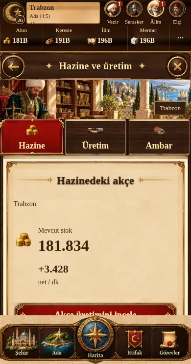
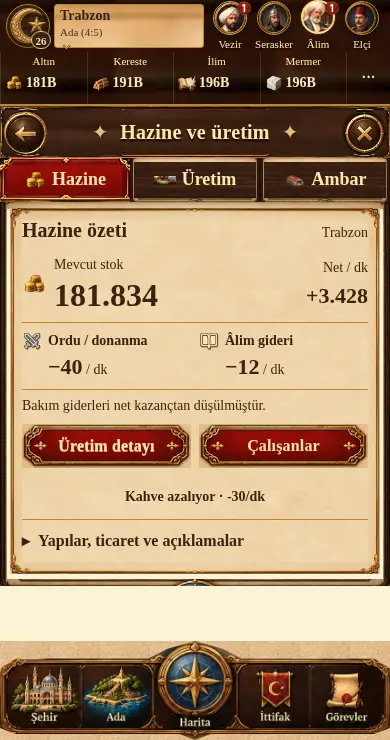
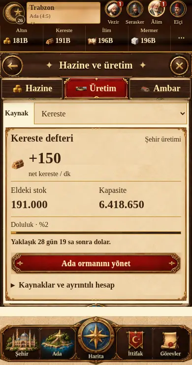
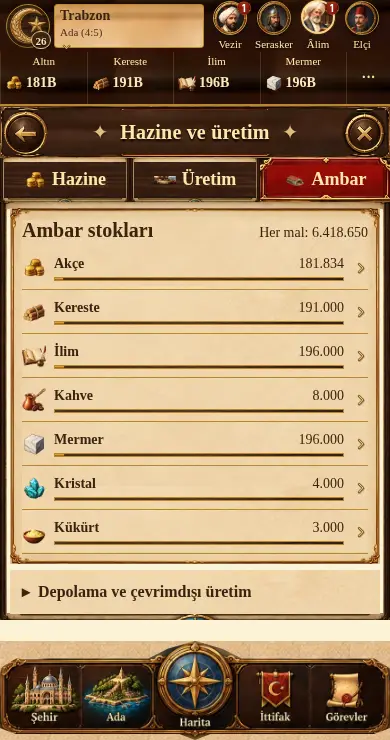

# Hazine, Üretim ve Ambar — tek bakışta özet

22 Kasım 2026 · 0.136.0 / SW161.

Kullanıcı sayfaların büyük olduğunu, temel bilgiye ulaşmak için kaydırmak istemediğini belirtti ve Hazine ekranını örnek verdi. Bu sürüm o sayfanın üç sekmesini sıkılaştırır. Genel tasarım hedefi: ana karar ve özet görünür; uzun açıklamalar isteğe bağlı. Bütün oyun sayfalarının aynı anda yenilendiği iddia edilmez.

- Hazine: stok, net kazanç ve iki bakım gideri tek defterde. Aynı net değer ikinci büyük kartta tekrarlanmaz. Net hız doğrudan motorun `rates` sonucudur; bakım yeniden düşülmez. Çalışanlar ve üretim bağlantıları doğrudan erişilir.
- Dolu stok, azalan kahve ve yolsuzluk uyarıları kapalı açıklamaların dışında kalır. Akçe stok sınırına ulaştığında ana stok etiketi de bunu gösterir.
- Üretim: yedi büyük seçim kartının yerine erişilebilir kaynak seçimi. Net hız, stok, kapasite, doluluk, dolma/tükenme tahmini ve yönetim eylemi ilk görünümde. Üretimin ayrıntılı kaynakları ve bütün yapı/orman/maden/işgücü bağlantıları açılır bölümde korunur.
- Ambar: yedi stok ve doluluk çizgisi birlikte. Üstteki kapasite her mala ayrı uygulanır. Kaynağa dokunmak gerçek üretim defterini açar. Depolama yapıları ve çevrimdışı süre açıklaması ayrıca açılır.
- Sekmeler 74px yerine 44px, ikon ve başlık yan yana. Ana stok rakamı 32px, gövde 14px; sayfaya ölçek/zoom uygulanmaz. Etkileşim alanları en az 44px. Sekme veya kaynak değişimi görünümü başa döndürür.

Onaylı ahşap/parşömen/kırmızı ipek atlası korunur. Dekoratif Hazine resmi ayrıntıda erişilir. Ekonomi, kaynak üretimi, stok sınırı, kayıt şeması, HUD ve arsa geometrisi değişmez.

## Gerçek ekranlar

Aynı yüksek seviyeli örnek şehir, 390×740 tarayıcı alanı. Önce 0.135 çıktısıdır; kullanıcının özel kayıt dosyası kullanılmadı.

## Kontrol sınırları

Normal yazı ve belirtilen telefon alanında kapalı açıklamalarla ana özetler tek ekrandır. Açıklama açıldığında, çok uzun içe aktarılmış sayılarda veya büyük erişilebilirlik yazısında doğal kaydırma kullanılabilir; yazı küçültülmez ve içerik kırpılmaz.

Doğrulama aracı `tools/treasury-overview-qa.cjs`: normal/boş/gerçek kapasitede dolu stok; 360/390/430px görünürlük; yedi kaynak seçimi, stok/net/bakım hesabının motorla eşleşmesi, salt okunur gezinme, gerçek bina bağlantısı, büyük yazı ve çok uzun kayıt sayıları. Genel arayüz denetimi `tools/layout-qa.cjs` ile yapılır.

## Sonuç

| 390×740, normal yazı | Önce gereken kaydırma | Yeni ana özet |
| --- | ---: | ---: |
| Hazine | 1692px | 0px |
| Üretim | 1051px | 0px |
| Ambar | 1485px | 0px |

[Önceki ölçüm](qa/treasury-0136/before.json), [19 hedefli senaryo](qa/treasury-0136/after.json), [genel arayüz sonucu](qa/treasury-0136/layout.json). 360 ve 390×740 alanında üç ana özetin ek kaydırması sıfırdır. 430px’de Üretim alt kenarında 2px ek alan ölçüldü; diğer özetler sıfırdır. Yedi kaynakta varsayılan üretim özeti, stok/net/bakım değerlerinin gerçek motorla eşleşmesi, salt okunur gezinmenin kaydı koruması ve ayrıntıdaki gerçek Konak bağlantısı sınandı. Boş stok, gerçek kapasitede dolu stok, büyük yazı ve çok uzun içe aktarılmış sayılar da denetlendi.

397 otomatik test; TypeScript, ESLint/CSS, kullanılmayan sınıf denetimi ve V2 bütçeleri geçti. Android statik dışa aktarımı ve telefon varlık hazırlığı tamamlandı. Tam 360px normal/%130 arayüz taramasında taşma, kesik yazı, küçük hedef, minik yazı, çakışma, isimsiz kontrol ve sayfa hatası sıfırdır.

Fiziksel cihaz ve imzalı APK/AAB doğrulanmadı; üretim yayını yapılmadı.
